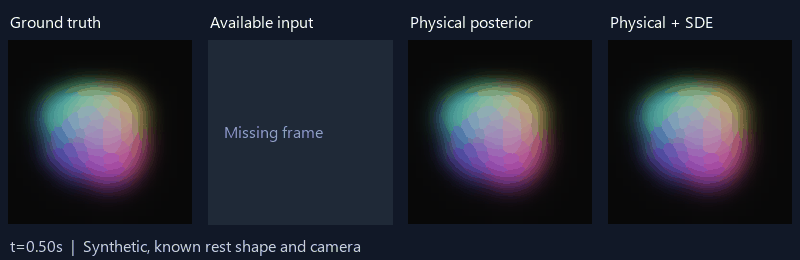

# PhysGauss-SDE

**Local CPU/GPU Bird run (20 October):** the first complete2,000-draw
stage fails45/733 strict monitors: worst Rhat1.01251, minimum bulk/tail
ESS256.58/131.34. Exact continuation to4,000 is active; no retained invalid
or divergent state steps occurred. All200 tests and an actual bit-identical
CUDA recovery proof pass. Raw checkpoints are permanently archived. No
predictive scores or wider comparison have been opened. See the
[local audit and protocol](docs/BIRD_LOCAL_SAMPLER.md).

Research prototype for physically constrained Gaussian scene reconstruction from **one moving camera with missing frames**.

**Bird recovery audit:** exact checkpoint recovery now passes on the real3350-draw
checkpoint. The mixing audit finds severe covariance conditioning and slow
mechanics/diffusion movement. A [reflected and interwoven sampler](docs/PACNERF_REFLECTED_SAMPLING.md)
preserves the existing physical posterior and is being tested on Bird alone,
using four independent free CPU workers. Bird convergence and uncertainty
validation remain pending; the wider comparison remains gated.

**Latest development:** all seven original CPU continuations have finished;
10/16 baseline cells pass convergence and six Bird cells remain ineligible.
The first single-Bird correction was stopped after unconverged trial paths
penetrated the known floor by tens of centimeters. The
[floor correction and inference protocol](docs/PACNERF_FLOOR_CORRECTION.md)
adds opaque-plane visibility and explicit non-penetration conditioning while
preserving exact Gaussian force integration. A conditional state-HMC/parameter-
slice sampler is being tested on Bird alone. The independent10,000-simulation
floor-conditioned check gives89.78% coverage for90% intervals; this is not
PAC calibration or a completed Bird result. The larger comparison stays gated.

**Current PAC-NeRF work:** the first exact-integral batch has finished with
9/16 converged cells; seven time-limited cells have been resumed on free CPU
workers with their original target and saved RNG. The
[overconfidence audit](examples/pacnerf-overconfidence-audit/audit.json) finds
large model error relative to narrow intervals and correlated image residuals.
A separately versioned [hierarchical uncertainty correction](docs/PACNERF_UNCERTAINTY_CORRECTION.md)
adds sampled mechanics/renderer-error scales, smooth modal loads and correlated
image errors. Its [independent 2,000-dataset interval test](examples/hierarchical-interval-validation/validation.json)
passes; this does not establish calibration on PAC-NeRF. The new workflow gates
fresh full runs on eight observed-only development pilots, preserves raw
checkpoints, and publishes new compact reports after independent replay.
The [first candidate](https://github.com/mohsenkhadem1/physgauss-sde/actions/runs/39143185132)
was stopped after its short pilots showed poor mixing despite valid density
checks. The [failure evidence](examples/pacnerf-discrepancy-inference-audit/stopped-pilot-proof.json)
is preserved. A parameter-dependent Gaussian state bridge and stricter pilot
mixing gates replace that sampler setup. Final PAC comparison results remain
pending; no calibration improvement is claimed yet.

**Next gate: one complete Bird posterior.** The
[single-case workflow](.github/workflows/pacnerf-bird-check.yml) runs only Bird
four-frame/constant/marginalized. It requires the original strict convergence
thresholds and independently replays raw uncertainty scores. The larger
comparison is dispatched separately after inspection. Predeclared development
guardrails require at least 80% coverage for its 90% intervals and CRPS no worse
than the baseline; these are not independent calibration evidence.

The [PAC-NeRF elastic transfer study](docs/PACNERF_EXACT_PROTOCOL.md) compares
constant versus frozen neural internal noise, each with analytically marginalized
or explicitly sampled Gaussian loads, on official Torus/Bird images. Four- and
six-view schedules mean three/five later dynamic images plus frame zero. Initial
geometry and all eleven initial appearance views are supplied. The reduced
graph mechanics and fixed-camera switching are declared approximations.

The historical four-point covariance/load integration experiment is
**superseded by a confirmed high-stiffness numerical defect**. Its
[historical report](examples/pacnerf-sparse/report.html) remains available for
audit and is not a corrected scientific ranking. The corrected model uses
exact coupled modal integrals. Exact causal innovation coordinates and a fixed
full-image Gauss-Newton metric assist nonlinear posterior sampling without
changing the physical model or force priors. The [four-arm observed-only pilot](examples/pacnerf-exact-pilot/report.html)
completed with verified density/target replays and one preserved rejected
large-energy proposal. The first sixteen-case study
[finished on GitHub Actions](https://github.com/mohsenkhadem1/physgauss-sde/actions/runs/39100239747)
and published its [audited results](docs/PACNERF_EXACT_RESULTS.md): nine converged
cells, seven compute timeouts, and poor uncertainty coverage. The full
comparison remains incomplete; no overall scientific ranking is claimed.
`.github/workflows/pacnerf-exact.yml` launches that comparison;
`pacnerf-exact-resume.yml` preserves saved references, kernels and RNG streams.
The [equation guide](docs/PACNERF_EQUATIONS.md) describes the model, exact load
elimination and innovation coordinates. Full checkpoints stay local and in
Actions artifacts; the user-approved [permanent checkpoint archives](docs/CHECKPOINT_ARCHIVES.md)
preserve original ZIPs separately for historical and corrected experiments.
Code, compact reports and archive integrity manifests are versioned here.

The latest [posterior audit and 36-case rerun](docs/POSTERIOR_RESULTS.md) fixes slow nonlinear posterior exploration with exact-target split Hamiltonian sampling. **All 36 cases pass complete finite-chain diagnostics**: maximum Rhat 1.00934, minimum bulk/tail ESS 821/556. Start with the [offline report](examples/converged-posterior/report.html), [equations](docs/POSTERIOR_INFERENCE.md) and [frozen protocol](docs/POSTERIOR_CONVERGENCE_PROTOCOL.md). Every model in that cube study marginalizes external forces.

With the same images, physics and frozen diffusion weights, stochastic-case gap errors change from **4.847 / 3.281 / 3.623 mm** (floor/constant/neural MAP) to **5.025 / 3.349 / 3.330 mm** (posterior means). The neural disadvantage largely disappears, but its 0.019 mm difference from constant noise does not establish superiority. A controlled oracle-amplitude ablation and tighter optimization show why better calibration alone could worsen a highest-density path. Passing sampler diagnostics does not validate the physical model or repeated-case uncertainty calibration; four of six stochastic neural cases still worsen under posterior averaging.

Run `python scripts/converged_sparse_comparison.py --case-index 29 --output runs/new-posterior` for the declared development case; `configs/converged_sparse_comparison.json` enumerates all 36 cases. The [reproduction guide](docs/POSTERIOR_RESULTS.md#reproduction-and-handover) includes parallel execution and independent smaller-step checks. **94 numerical tests pass.** The optional `pip install -e '.[performance]'` accelerates tensor contractions without changing equations. This remains a known-scene synthetic prototype, with no real-video or unknown-geometry/camera validation.

The earlier physical/noise implementation is version **0.8.1**. Its [114-fit calibration study](docs/CALIBRATED_NOISE_RESULTS.md), [method](docs/CALIBRATED_NOISE_METHOD.md) and [report](examples/calibrated-noise/report.html) remain versioned. Noise-amplitude error is **0.295% on 20 fresh synthetic test motions**. Separately calibrated simultaneous-gap prediction sets cover **19/20 constant** and **20/20 neural** motions with 21.7/26.3 mm widths and broad statistical uncertainty. Its failed 1,548-monitor pCN audit is historical evidence, superseded for the 36 benchmark posteriors by the new sampler; the 40 fresh-test posteriors have not been rerun. Prediction-set coverage and posterior convergence answer different questions.

The [historical v0.7 36-fit comparison](docs/NEURAL_MARGINAL_RESULTS.md) reported 4.85/2.89/2.97 mm with floor/constant/neural noise and found poor neural calibration in the operating regime. [Its original report](examples/neural-marginal/report.html) is preserved. The initial v0.8 cross-machine failure and superseded results are retained in `examples/calibrated-noise-diagnostics`; the final study uses the corrected physics projection and fresh test seeds.

The [accurate pipeline](docs/ACCURATE_PIPELINE.md) implements and tests both numerical fixes. Its [20-fit independent-reference comparison](docs/ACCURATE_RESULTS.md) is complete: deterministic integration error falls from about **3.3 mm to 0.130 mm coordinate RMSE** against RK4-96. With both fixes, six-view gap reconstruction error is **1.01 mm** without loading and **1.14 mm** with a pulse, versus **2.86 mm / 3.65 mm** for the legacy pair on the same new images (the legacy pulse fit stalls). [Open the offline report and actual images](examples/accurate-reference/report.html). All ten corrected marginalized view fits pass stationarity; alternating inference still fails both six-view cases. Local uncertainty remains uncalibrated.

Run `physgauss accurate --plan configs/accurate_reference_study.json --output runs/accurate-reference` to reproduce the new comparison, including component controls and five view schedules. Historical experiments remain versioned.

The preceding [simulation and view audit](docs/SIMULATION_VIEW_AUDIT.md) found a material accuracy limit: the historical integration step has about **3.3 mm coordinate error** against converged independent RK4, despite consistent force formulas and momentum balances. Historical results are discretized-model experiments, not validated millimetre-level physical reconstruction. [Historical images, camera coverage and ten extra view-count fits](examples/simulation-view-audit/report.html), plus high-accuracy reference inputs, remain committed. The version-0.6 results above address the two numerical issues; physical validation and posterior calibration remain open.

The initial milestone is a small, reproducible CPU experiment. It is not a reproduction of PIDG or a completed real-video reconstruction system. We separate uncertainty over unknown scene parameters from stochastic forcing, and evaluate both against synthetic ground truth.

## Implemented first milestone

- Volumetric tetrahedral Neo-Hookean mechanics with fixed material mass and explicit supports.
- Gaussian primitives whose positions and covariances follow the material deformation.
- Known moving camera; deliberately irregular observation times and a contiguous missing interval.
- Image-based inference over stiffness, damping, and initial state.
- A correlated neural diffusion field, trained on an independent synthetic calibration task.
- Joint approximate inference over parameters and latent stochastic increments using observations on both sides of a gap.
- Held-out rendering, trajectory, uncertainty, and physical-consistency metrics.

## Setup

Use Python 3.10 or newer. Install the appropriate PyTorch build for your platform first if needed.

```sh
python -m venv .venv
# Windows: .venv\Scripts\activate
# Linux/macOS: source .venv/bin/activate
python -m pip install -e .
```

```sh
physgauss check
physgauss demo --quick --output runs/smoke
physgauss demo --config configs/cpu_demo.json --output runs/cpu-demo
# Matched control: ground truth has no process noise.
physgauss demo --config configs/cpu_deterministic.json --output runs/deterministic-control
# Reuse matching fits and rebuild posterior samples/report:
physgauss demo --config configs/cpu_demo.json --output runs/cpu-demo --resume
```

Open `runs/cpu-demo/report.html` for an animated comparison, trajectory/uncertainty plots, and scores. The report is self-contained. The run also saves a configuration, JSON measurements, input observations, posterior trajectories, and a checkpoint. Source fingerprints prevent accidental reuse after a code change. Partial checkpoints can resume the remaining fit.

The default experiment uses 21 timestamps, six observed RGB frames, a 0.3-0.7 second observation gap, 24x24 images, and 64 posterior samples. All six input frames contribute to offline smoothing. This is deliberately small enough to inspect and run on CPU; it is not a high-resolution scene reconstruction.

`physgauss check` runs 87 numerical and physical checks, including independent observed-curvature identities, fixed spatial projection, empty-slab derivatives, conformal splits, Gaussian force elimination, conservation, stochastic refinement and rendering/integration accuracy. GitHub Actions runs the historical smoke commands and the calibrated-noise pipeline; separate workflows execute all final comparison and validation partitions.

## Analytically marginalized forces

Version 0.5 infers the solver-step trajectory and mechanics together, integrates the Gaussian force coefficients analytically, then recovers a force distribution including trajectory uncertainty. A matched comparison uses alternating force/mechanics updates, joint explicit-force optimization and marginalization under exactly the same trajectory model.

```sh
physgauss marginalize --quick --output runs/marginal-smoke
physgauss marginalize --plan configs/marginal_force_study.json --historical-summary examples/force-study/summary.json --output runs/marginal-force-study
```

Read [the derivation, covariance identities and comparison protocol](docs/FORCE_MARGINALIZATION.md). The new model declares full-rank free-node velocity diffusion; it differs from the historical simulator's absent or balanced low-rank neural noise. Force elimination is exact for this model. The trajectory posterior remains a local Gaussian approximation, and material/load identifiability remains unresolved. Historical simulator scores provide context rather than isolating marginalization's effect.

The [completed 12-fit comparison](docs/MARGINALIZATION_RESULTS.md) and [self-contained report](examples/marginal-force-study/report.html) are committed with exact input images, fitted paths and portable force distributions. Marginalized, joint and alternating solvers pass the local stationarity screen in 2/4, 1/4 and 0/4 conditions respectively. Accuracy is similar; no consistent advantage over joint optimization is established. Independent posterior-approximation diagnostics fail in the pulse and stochastic cases. [Depth-order step scans](examples/marginal-step-diagnosis/) expose visibility-related objective discontinuities; uncertainty remains provisional.

## Structured external-force distributions

Version 0.4 infers a smooth external load, fixed-amplitude internal SDE impulses, or both, through the observed RGB frames. Fifteen Gaussian-prior coefficients describe three loading directions over five temporal inducing points. Nodal loads use a known material-attached spatial profile; this is not arbitrary force-location inference. Outputs include force means, intervals, covariance and finite-window impulses, with explicit N/Ns units and convergence checks.

```sh
physgauss forces --quick --output runs/force-smoke
physgauss forces --plan configs/force_study.json --output runs/force-study
physgauss forces --plan configs/force_study.json --output runs/force-study --resume
```

See [the force prior, nonlinear target, diagnostics and controlled protocol](docs/FORCE_POSTERIOR.md). The full plan compares no load, a deterministic external pulse, internal stochastic forcing, and both, using the same images per model. There are no inferred model probabilities. A zero external-force band in the SDE-only model reflects an excluded component, not a conclusion that the force is absent. Inspect chain diagnostics before trusting any interval.

The [completed 12-fit experiment](docs/FORCE_RESULTS.md), [self-contained report](examples/force-study/report.html), and [portable posterior files](examples/force-study/cases/) are versioned. All twelve fits fail the full convergence screen at the tested budget. Force estimates and covariance are therefore provisional, despite passing software/numerical checks. Published files carry their diagnostic status and source/data provenance.

## Adaptive noise and independent-realization study

Version 0.2 adds an explicit zero-process-noise component and observation-only inference over noise scale. It analytically integrates scene parameters and stochastic increments under a common local image likelihood. Matched no-noise, fixed-SDE, and adaptive-mixture controls use the same inference approximation. Positive scale does not automatically mean physical randomness: the study also tests an unmodelled deterministic force.

```sh
physgauss study --quick --output runs/scale-smoke
physgauss study --plan configs/scale_study.json --output runs/scale-study
physgauss study --plan configs/scale_study.json --output runs/scale-study --resume
```

See [the adaptive-noise method and study protocol](docs/ADAPTIVE_NOISE.md). The full plan contains 18 cases: three independent seeds, two matched six-image schedules, and three ground-truth conditions. Coverage, interval width, CRPS, ranking metrics, scale-prior sensitivity, and linearization error are recorded. This remains a known-geometry experiment.

The [completed 18-case results](docs/SCALE_RESULTS.md) and [self-contained study report](examples/scale-study/report.html) are versioned. Adaptive inference suppresses unnecessary noise in deterministic cases and improves the stochastic cases in this small study. Unmodelled deterministic forcing still produces severe under-coverage and a nonzero inferred noise scale.

## Nonlinear likelihood audit

The local likelihood can be fragile even when average pixel error is small. The new audit evaluates independent proposals using the full nonlinear observed-image likelihood and records importance-weight ESS, concentration, physical failures, and source compatibility. It does not call reweighted intervals calibrated.

```sh
physgauss audit --study runs/scale-study --source-ref HEAD --output runs/likelihood-audit --samples 256
```

That command targets a fresh study from the current committed checkout. The historical milestone-2 raw local run requires `--source-ref d225760`. See [audit equations and provenance requirements](docs/LIKELIHOOD_AUDIT.md).

The [completed audit](docs/AUDIT_RESULTS.md) evaluated all 18 configurations with 256 proposals per method. Adaptive proposals fell below the predeclared relative-ESS threshold in **14 of 18 configurations**. The apparent accuracy gains therefore do not establish reliable nonlinear posterior uncertainty. The [audit report](examples/likelihood-audit/report.html) records the failures and their source provenance; a nonlinear smoother/sampler is the next inference milestone.

## Nonlinear Metropolis sampling

The `sample` command uses the full nonlinear physics/rendering likelihood for every Metropolis decision. The local Gaussian mixture preconditions pCN, independent, and scale-transport proposals. Its scale weights no longer determine the final posterior by themselves. Proposal adaptation stops after warmup; rank-normalized/folded split Rhat and bulk/tail ESS monitor every scene/noise coordinate, observed log likelihood, and adaptive process scale.

```sh
physgauss study --quick --output runs/new-local-reference
physgauss sample --study runs/new-local-reference --source-ref HEAD --output runs/nonlinear-smoke --warmup 20 --draws 32 --evaluation-samples 16
```

Use a clean committed source ref matching the study. For the historical local `runs/scale-study`, use `--source-ref d225760`. Full default settings use four chains, 1,000 warmup transitions and 2,000 retained transitions per chain. Add `--langevin` for gradient-guided pCNL with the full reverse-proposal correction. Add `--case stochastic__long_gap__3101` to select one exact case; repeat `--case` for more. Failed convergence diagnostics leave predictions explicitly provisional. See [the target, transition derivation, diagnostics and reproduction instructions](docs/NONLINEAR_SAMPLING.md).

The [selected long-gap experiments](docs/NONLINEAR_RESULTS.md) and [self-contained sampler report](examples/nonlinear-sampling/report.html) record deterministic, stochastic and missing-force cases with four chains each. They include convergence failures despite accurate-looking trajectories. This is a numerical investigation on one geometry and one realization seed, not a new calibration benchmark. The [next development sequence](docs/NEXT_EXPERIMENT.md) describes nonlinear proposal fitting, structured external forces, material viscosity, uncertain cameras and partially observed geometry; those extensions are not yet implemented.

## Historical first measured results

Both experiments ran locally and CI passed on Linux. In the stochastic synthetic realization, missing-interval free-node coordinate RMSE was 2.794 mm for uncertain deterministic mechanics and 1.340 mm with the neural SDE. In the deterministic control the results were 1.221 mm and 1.244 mm, respectively. The SDE intervals were substantially wider and over-covered the truth in both cases. This is a useful ablation, not a calibration or generalization claim.

See [complete measurements and interpretation](docs/RESULTS.md), the [stochastic report](examples/cpu-demo/report.html), and the [deterministic control report](examples/deterministic-control/report.html). Download/open the HTML reports locally; GitHub's file viewer does not execute them.



## Research boundaries

The first benchmark assumes known rest geometry, density, camera poses, appearance, and material family. These assumptions deliberately isolate motion inference. Geometry completion, camera estimation, contact inference, and real-video fitting are later milestones. A Gaussian's spatial covariance represents material extent; posterior uncertainty is represented separately. The neural diffusion amplitude is trained using independent simulator-generated innovations, not inferred from a single video.

See [docs/METHOD.md](docs/METHOD.md) for equations, likelihood, physical units, and limitations of the posterior approximation.

## Project map

| Module | Purpose |
| --- | --- |
| `physics.py` | Volumetric elasticity, integration, supports, conservative internal impulses |
| `render.py` / `camera.py` | Deformation-coupled splatting and known pinhole camera paths |
| `stochastic.py` | Neural noise amplitudes and correlated spatial basis |
| `benchmark.py` | Separate observation and evaluation data; explicit scene priors |
| `inference.py` | Joint MAP smoothing and local Gauss-Newton Laplace approximation |
| `scale_inference.py` | Integrated scale evidence and zero-noise/positive-noise posterior mixture |
| `study.py` / `study_report.py` | Matched controls, independent realization/gap sweeps, and aggregate reports |
| `likelihood_audit.py` / `audit_report.py` | Nonlinear likelihood overlap and reproducibility diagnostics |
| `mcmc.py` / `chain_diagnostics.py` | Nonlinear Metropolis transitions and multichain Rhat/ESS |
| `nonlinear_study.py` / `nonlinear_report.py` | Observation-only sampling, isolated predictive evaluation and trace reports |
| `forces.py` / `force_inference.py` | External-load GP projection and nonlinear fitted-proposal correction |
| `force_study.py` / `force_report.py` | Conditional force/noise comparisons, force/impulse distributions and reports |
| `metrics.py` / `report.py` | Predictive scores, physical diagnostics, and experiment report |
| `cli.py` | Reproducible execution and checkpoint handling |

## Handover

See [HANDOVER.md](HANDOVER.md) for current status and [docs/RESEARCH.md](docs/RESEARCH.md) for the experimental plan. Development uses small pushed commits. The repository includes source, configurations, tests, compact result snapshots, and self-contained reports. Generated raw data and large checkpoints are excluded and reproducible through the run commands.

