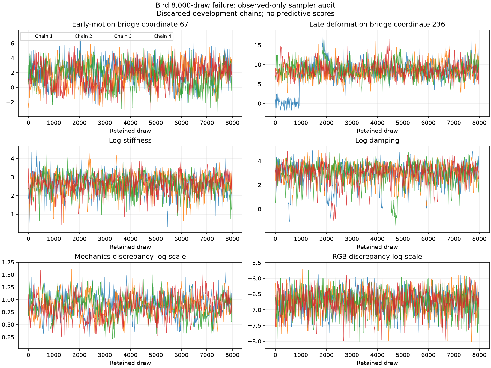

# Local Bird sampler audit and correction

The 20 October 2026 four-chain, 8,000-draw reflected/interwoven run fails
88 of 733 monitors. Its maximum Rhat is 1.0339864; minimum bulk/tail ESS is
134.50/33.23. The old samples are discarded proposal-training data for this
experiment. No withheld particle positions inform the audit or proposal.

## Variables that still fail

The complete list, human-readable physical indices, original diagnostics,
input/reference/checkpoint hashes and exact cached-density replay are in
[`audit.json`](../examples/bird-local-sampler-audit/audit.json).

| Group | Failed monitors | Interpretation |
|---|---:|---|
| Physical parameters and path | 49 | Early rigid modal motion, late deformation, damping and mechanics discrepancy |
| Gaussian-bridge coordinates | 30 | The remaining state correlations, plus parameter counterparts |
| Conditional Gaussian load means | 8 | Load/path dependence remains poorly explored |
| Covariance normalizers | 1 | `logdet_Q`, associated with mechanics discrepancy |

The largest Rhat belongs to `physical_67`: frame 3 displacement, mode 5
(1.0339864, bulk ESS 172.32). The smallest tail ESS belongs to `native_236`:
the frame-10/mode-6 bridge displacement coordinate (33.23), closely followed
by physical frame-10 displacement mode 6 (34.69). Initial modes 0–5 are the
infinitesimal rigid modes; 6–11 are deformation modes. These are coordinates
of a fixed linear modal approximation, not independent real-world motions.

Log damping fails its tail ESS (311.80), and mechanics discrepancy fails
Rhat/bulk ESS (1.01588/308.44). Stiffness, smooth-load scale, RGB-error scale
and the overall log target pass their existing screens. A passing log-target
trace therefore does not establish path mixing.



## Fixed proposal correction

The previous floor-free guide learned only a five-parameter covariance and
left state covariance equal to identity. The actual 32,000 native bridge
draws have covariance eigenvalues 0.005721–17.814 (condition ratio 3,113.69).
The new fixed reference uses their full mean and covariance, including
state/parameter cross-correlation, with 2% shrinkage towards its empirical
diagonal and an absolute 0.001 ridge. All training draws are discarded.

The existing conditional Schur factorization preserves physical parameters
during state updates. Its dense state transform also transforms the linear
reflection walls. Exact reflected Hamiltonian state moves and both centered
and noncentered parameter slice moves retain the original floor-conditioned
hierarchical physical density. Gaussian load integration, all state-dependent
covariance determinants, guide Jacobians, observed pixels and floor likelihood
remain unchanged. The outer affine Jacobian is constant and cancels from
acceptance ratios. The new reference is a proposal, not a posterior mode.
Initial physical paths are preserved within 2.14e-14.

## Local CPU and GPU execution

This machine has an 18-core Intel i9-9980XE and four RTX 2080 Ti GPUs.
Mechanics, bridge factorization, reflection geometry and random streams remain
on CPU. The optional device adapter moves the full float64 floor-aware renderer
and its differentiable pose inputs to a selected GPU, then returns RGB to CPU.
It changes neither pixel selection nor precision. On actual Bird endpoints,
RGB differences are below 7e-16 and maximum pose-gradient differences below
6e-14. The full target on 16 stratified historical states agrees within
3.64e-12; see `cpu-cuda-target-replay.json` beside the audit.

The isolated environment uses Python 3.12.3, Torch 2.14.1+cu130 and
opt-einsum 3.4.0. The full regression invocation passed 192 tests in 154.77s;
the three added composition/device/index tests also passed separately.

```sh
python experiments/bird_local.py prepare \
  --gate runs/bird-8000/convergence.json \
  --reference runs/reference-original/reference.pt \
  --output runs/bird-preconditioned-reference

python experiments/bird_local.py run \
  --reference runs/bird-preconditioned-reference/reference.pt \
  --output runs/bird-local-pilot/chain-0 \
  --chain-index 0 --seed 1070009 --device cuda:0 \
  --warmup 128 --draws 256
```

Repeat the pilot for indices 1–3, seeds 1070010–1070012, and devices 1–3.
An initial CPU-only chain-3 trial was stopped after its 25-step warmup
checkpoint because it was substantially slower; its checkpoint is preserved
separately and its draws are not pooled with the GPU trial.

Pilot results are development diagnostics only. Fresh full chains require at
least 500 discarded warmup steps and 2,000 retained draws each, four distinct
seeds, exact checkpoint replay, Rhat <1.01 and bulk/tail ESS >=400 for every
physical/native/load/normalizer monitor, and zero retained invalid/divergent
state transitions. Independent prediction-score replay and the original
development readiness checks follow convergence. No wider comparison is
eligible before both gates pass. Passing one Bird case cannot establish
independent uncertainty calibration.

## Deterministic scalar-parameter correction and full test

The first dense-reference pilot (128 warmup/256 draws per chain) gives
maximum Rhat 1.22659 and minimum bulk/tail ESS 29.34/21.82. It improves late
mode-6 movement but leaves early motion and the mechanics-discrepancy scale
slow. Its full failed diagnostic report is retained in `pilot-v1/`.

A second kernel composes the joint five-parameter elliptical slice with five
individual coordinate slices, in both physical and bridge parameterizations.
Each component leaves the same conditional invariant. New discarded pilots
use seeds 1270009–1270012. Maximum Rhat is 1.10772 and minimum bulk/tail ESS
26.03/98.29. There are zero retained invalid/divergent state steps. The RGB
and smooth-load scales pass all strict scalar diagnostics already; motion
and mechanics discrepancy remain slow. The complete report is in `pilot-v2/`.
These unequal short development trials do not establish a scientific ranking
or replace the full four-chain convergence test.

The first CUDA recovery trial exposed nondeterministic last-bit gradients:
32 draws differed from a 16+16 run despite preserved saved prefixes. The
failed trial is retained in `non-deterministic-prototype-recovery-failure.json`.
Enabling deterministic algorithms and `CUBLAS_WORKSPACE_CONFIG=:4096:8`
fixes it. The actual Bird 32-versus-16+16 GPU proof now matches samples,
densities, energy errors, RNG, step size and all transition counters bit for
bit; see `actual-gpu-recovery-proof.json`. These proof draws are discarded.
All 197 regression tests pass in 171.96s, including independent funnel
quadrature and interrupted warmup/retained recovery for the new composition.

The frozen full test is `configs/bird_local_preconditioned.json`: four fresh
seeds 1170009–1170012, 500 discarded warmup, 2,000 retained draws extended
unchanged to 4,000/8,000 only if needed. The 256-draw pilots are never pooled.
The coordinator is local and bounded; it never dispatches the wider matrix:

```sh
python -u experiments/run_local_bird.py --output runs/bird-local-production
```

`experiments/validate_local_bird.py` first recomputes all observed-only gates
from raw shards, then independently checks integrals, full rendering, floor
likelihood and NumPy/Torch scores before applying the unchanged development
coverage/CRPS/floor guardrails. No new convergence or uncertainty improvement
is claimed until those recorded checks pass.


## Permanent raw archives and live full-run status

The original parent diagnostic ZIP and all new development checkpoints are
[preserved on the artifact branch](https://github.com/mohsenkhadem1/physgauss-sde/tree/e58249361bdb8d6c47c9b1432e798f8be7ad2514/local-artifacts).
The original ZIP is byte-identical to GitHub artifact12268611805 (81,465,907
bytes, SHA-256c9b1e4999a0488421bcb9815b93bb0f6e2211801c65ff1b86fc7e544df304819).
The 21MB new development ZIP contains101 files, including discarded pilot,
recovery and warmup states, original/preconditioned references and exact inputs.
Every uploaded Git blob hash matches its local file; reassembly and SHA-256
manifests are provided. These archives contain no new production posterior draws.

The state-only native covariance has eigenvalues0.12576–17.70330; after linear
conditioning on parameters its range is0.12486–11.69271. The largest state/
parameter canonical correlation is0.93130. The full native condition ratio
3,113.69 reported above includes parameter scales as well as state directions.
See `preconditioning-geometry.json` for the distinction. These remain discarded,
unconverged proposal-training moments, not calibrated posterior summaries.

The fresh full run is active locally with immutable numerical worker
`4f0f0fcbfd518bd7be9b77001f5b23f34d5541dc`. All four chains completed500
warmup steps and entered retained sampling. Use
`runs/bird-local-production/execution.json` and `chain-*.log` for live status.
The coordinator preserves exact RNG/kernel prefixes through declared budgets.
There is no full convergence result yet. `archive_local_bird.py` losslessly
packages the stopped full run and refuses to archive a changing live run.


## Observed-only full-run previews and a separate development transport

A300-draw prefix fails335 monitors, with maximum Rhat1.18053 and minimum
bulk/tail ESS15.67/11.64. The500-draw prefix improves to202 failures,
Rhat1.07227 and ESS40.65/29.97. These prefixes are observed-only diagnostics;
neither replaces the full declared budgets or opens predictive labels.
Raw prefix tensors are preserved with the full run. Individual diagnostics
and labels are under `production-preview-300/` and `production-preview-500/`.
Remaining slow directions include late rigid mode0 and the mechanics-
discrepancy scale; fast RGB and smooth-load scales cannot certify motion mixing.

While the immutable full run continues, a separate observed-only experiment
fits a quadratic parameter-dependent native-state mean and a smooth bounded
positive residual scale using the same discarded32,000 old draws. Its dense
residual root and all new state-map log determinants are explicit; physical
priors, contact/floor conditioning, observed images and Gaussian force
integration are unchanged. `bird_conditional_bridge.py` and
`trial_conditional_bird.py` implement this development proposal. Starting
physical paths are preserved to4.27e-14. Three additional tests check both
force arms' inverse/density Jacobians, transformed floor walls, centered
interweaving and parameter derivatives against finite differences. The
independent determinant test uses contiguous LAPACK input after an initial
noncontiguous batched-LU platform failure; no physical model was altered.

The128-warmup/128-draw development pilot uses seed1370009, four chains with
shared warmup adaptation, and GPU2 alongside CPU mechanics. It is explicitly
ineligible as a final production result. No old, pilot or new-target samples
are pooled, and its outcome does not alter the existing full-run kernel.
