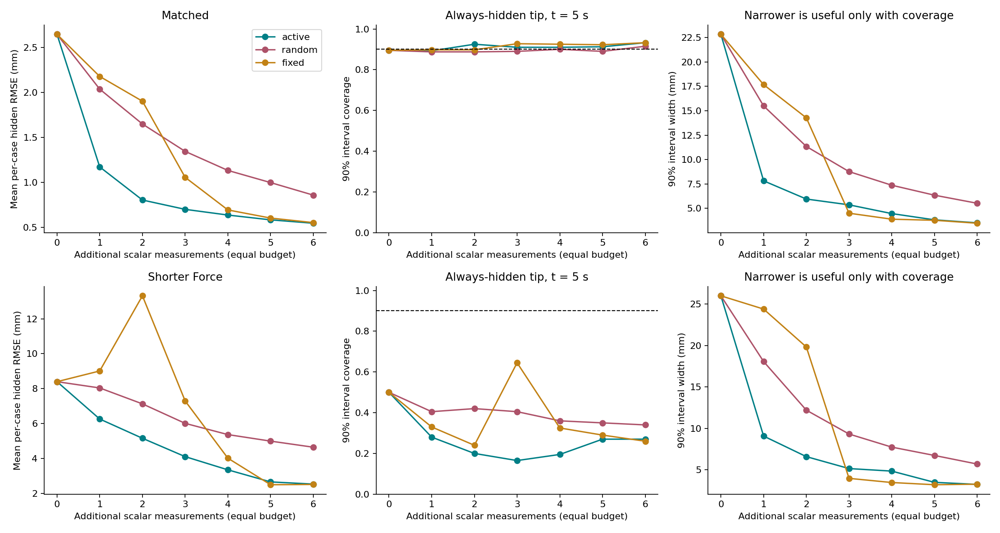

# Active beam comparison: completed local CPU results

The policy chooses an additional view or calibrated probe by integrating the
expected hidden-deformation prediction variance over possible measurements.
Unknown forces are marginalized, and all support hypotheses remain in the
posterior. [Method and reproduction](../../docs/BEAM_ACTIVE_DESIGN.md).

400 matched-model cases; 200 faster-varying-force stress cases. Three policies,
the same initial sparse observations, and six equal-cost scalar actions each.
Ground truth uses 80 FEM elements; inference uses 40. Total study runtime on
local CPU: 162.4 seconds, excluding final plotting and archive verification.

| Extra actions | Active hidden RMSE (mm) | Random (mm) | Fixed (mm) |
|---:|---:|---:|---:|
| 0 | 2.644 | 2.644 | 2.644 |
| 1 | 1.172 | 2.036 | 2.177 |
| 2 | 0.805 | 1.649 | 1.902 |
| 3 | 0.701 | 1.345 | 1.057 |
| 4 | 0.638 | 1.134 | 0.695 |
| 5 | 0.585 | 0.998 | 0.605 |
| 6 | 0.547 | 0.859 | 0.554 |

The strongest benefit is early measurement efficiency. At two actions active
reduces hidden RMSE by 51% versus random and 58% versus the chronological fixed
schedule. Paired 95% bootstrap intervals for active minus baseline are
[-0.958,-0.730] mm and [-1.225,-0.974] mm respectively. At six actions the
advantage over random remains 36%; over fixed it is only 1.25%
(-0.00692 mm, interval [-0.01313,-0.00182]).

In 366/400 matched cases active and fixed end with the same six measurements;
their posteriors then agree numerically, regardless of acquisition order.
These results support useful action ordering. They do not isolate the benefit
of feedback over an independently optimized, nonadaptive action ordering.
Fixed was strengthened after a small implementation pilot to use the same
strong distal probe; see the disclosure in the frozen configuration.

For active, the hidden tip's 90% interval width falls from 22.83 to 3.52 mm.
Empirical coverage changes from 89.5% to 93.25% (Wilson interval 90.36–95.32%).
The final intervals are slightly conservative; every declared matched-model
scalar check passes. At six actions fixed has the same coverage, slightly
narrower width (3.48 mm), and a slightly better interval score (3.94 versus
4.00 mm). Active does not dominate every uncertainty metric.

The stress test exposes a serious limitation: active reduces hidden RMSE from
8.394 to 2.525 mm, but its final nominal 90% interval covers only **27%** of
truths. Random ends at 4.638 mm / 34%; fixed at 2.504 mm / 26%. The active-fixed
error difference is not resolved by the paired interval [-0.028,0.083] mm.
All stress calibration gates fail. More confident predictions under a wrong
temporal force prior are not validated uncertainty.

Validation: 11 beam tests pass, including independent dense Gaussian
conditioning, numerical quadrature and analytic mechanics checks. Every one
of 12,600 saved posterior states replays with maximum absolute difference
1.42e-14. Conditional covariance PSD, budget, no-repeat, shared measurements,
active score minimization and identical-final-set invariance all pass. The
order-61 quadrature audit changes no selected actions; maximum normalized
score difference is 0.0000273 matched and 0.00189 under stress.

- [HTML report](report.html)
- [All metrics and declared protocol](results.json)
- [Archive verification](verification.json)
- [Execution/source hashes](execution.json)
- [Matched observations, action logs and tip posteriors](matched-dataset.json.gz)
- [Stress observations, action logs and tip posteriors](shorter_force-dataset.json.gz)

The benchmark assumes replayable quasistatic loads, known cameras/material,
ideal probe calibration and tracked centres. It does not establish real-image
performance, online camera control, general contact inference, or nonlinear
deformable-object calibration.
