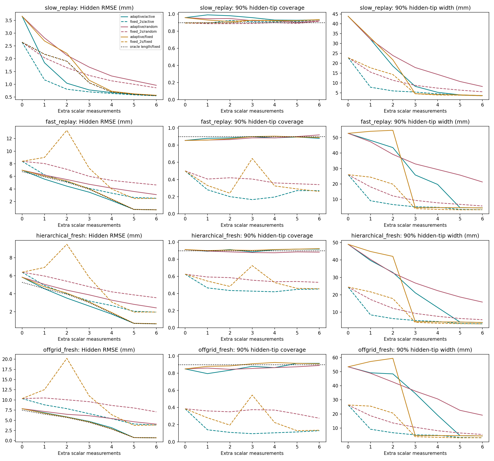
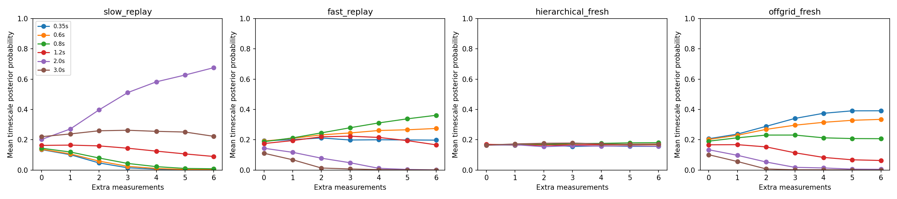

# Adaptive force prior: audit and completed comparison

The failure was mainly temporal misspecification: the old 2-second force prior
strongly suppressed rapid force modes. Its conditional covariance could shrink
as data arrived even when its predictions were wrong. Dense-conditioning tests
and archive replay confirm that the old solver was computing its stated model;
this was not an unconverged sampling chain.

The replacement maintains a joint posterior over boundary configuration and
force timescale, with six timescales from 0.35 to 3 seconds. Observations update
their probabilities. Forces remain analytically marginalized, and prediction
intervals retain uncertainty both within and between timescale hypotheses.
Material, observation noise and force amplitude are unchanged.

## What is the active policy?

It uses **both observations and uncertainty**. Observations determine the current
posterior. The policy then chooses the additional view or calibrated force
probe with the largest expected reduction in hidden-deformation prediction
variance. Each possible observation is averaged over the full predictive
distribution. The actual measurement updates the posterior only after selection.

This is a one-step Bayesian decision rule, not a neural/RL policy. It does not
simply select the most uncertain visible point or maximize boundary-label
certainty. It scores how much an action should improve the SAME hidden-motion
task, and receives neither hidden truth nor unselected observations.

## Faster-force cases: uncertainty is substantially improved

The same 200 cases that previously failed were replayed with identical inputs.
After six measurements:

| Prior / policy | Hidden RMSE (mm) | 90% tip coverage | Mean interval width (mm) | Interval score (mm), lower is better |
|---|---:|---:|---:|---:|
| Old 2s prior / active | 2.525 | 27.0% | 3.253 | 76.54 |
| Adaptive / active | 0.697 | 88.0% | 4.441 | 5.67 |
| Adaptive / random | 3.104 | 92.0% | 21.270 | 28.82 |
| Adaptive / fixed | 0.697 | 89.0% | 4.445 | 5.63 |
| True timescale supplied / fixed | 0.694 | 88.5% | 4.438 | 5.61 |

For active selection, error decreases 72.4%, while the interval score improves
from 76.54 to 5.67 mm. This is more than simply inflating intervals. The 88%
coverage has a Wilson 95% interval of [82.77%,91.80%]. Every declared scalar
check passes across all seven stages of all three adaptive policies in this
fast-force population; this is finite-sample evidence, not exact calibration.

The oracle-timescale diagnostic closely matches adaptive performance. On the
same FIXED action sequence, the old model classifies 66.5–79.5% of acquired
measurements as outside its predictive 95% interval; adaptive reduces this to
2.5–8.0%. These observations are scored before their updates. The old model
also mispredicts the calibrated probe, showing that force-prior misspecification
propagates through the support posterior, not just the unseen temporal samples.

After two actions, adaptive hidden RMSE is 4.448 mm active, 5.500 random and
5.270 fixed. The active-minus-fixed paired bootstrap interval is
[-1.212,-0.449] mm. After six, active and fixed are indistinguishable:
difference 0.000054 mm, interval [-0.00516,0.00543]. They have exactly the same
final observation set in 182/200 cases, with matching posteriors.

## Fresh validation and remaining limits

The complete study has 1,200 cases and crosses both priors with all three
policies, plus the explicitly privileged true-timescale diagnostic.

| Population | Cases | Old active RMSE | Adaptive active RMSE | Adaptive random RMSE | Adaptive fixed RMSE | Adaptive active 90% coverage |
|---|---:|---:|---:|---:|---:|---:|
| Slow-force replay, true 2s | 400 | 0.547 | 0.563 | 0.959 | 0.567 | 93.25% |
| Fast-force replay, true 0.8s | 200 | 2.525 | 0.697 | 3.104 | 0.697 | 88.0% |
| Fresh hierarchical-prior draws | 400 | 1.943 | 0.640 | 2.418 | 0.650 | 91.75% |
| Fresh off-grid timescale, true 0.5s | 200 | 3.834 | 0.693 | 4.060 | 0.697 | 91.5% |

Errors are mean per-case RMSE in mm over hidden regions and all eight times.
Coverage concerns the never-observed tip at time 5s, not a simultaneous path.

All stages/policies pass the marginal calibration checks on the fresh population
drawn from the complete hierarchical prior. At six actions, its active, random
and fixed coverages are 91.75%,88.25%,92.25%. Averaged timescale probabilities
stay near the prior in this balanced population, as expected; this does not
mean individual cases fail to adapt.

Adaptation has costs and remaining failures:

- For truly slow forces, active error rises slightly from 0.547 to 0.563 mm
  (paired difference +0.01587 mm, interval [0.00987,0.02240]). Early intervals
  are too conservative: active coverage reaches 99% and 98% at steps 1 and 2.
  Its steps 0–3 fail the declared checks; random fails steps 0 and 2; fixed
  fails step 0. Final checks pass. Allowing unknown roughness sacrifices some
  precision relative to correctly knowing the true smoothness in advance.
- The fresh 0.5s population is absent from the timescale grid. Final coverage
  improves from 13% to 91.5%, but active steps 1 and 2 fail, with coverages
  79.5% and 83.5%. Robust calibration at every early stage is not established.
- This learns a single timescale per episode. It does not validate jumps,
  changing within-episode smoothness, unknown force amplitude, new contacts,
  wrong material/camera/noise, or nonlinear mechanics.
- Fixed is a strong spatial/probe design with chronological time ordering.
  The comparison does not isolate feedback benefit over an optimized
  nonadaptive ordering, and active need not win every metric or budget.

## Verification and reproduction

The full run took 363.1 seconds on four local CPU workers. No GPU or paid
service was used. Sixteen beam tests pass. All 58,800 saved posterior states
replay with zero recorded metric difference; interval endpoints reproduce the
mixture CDF within 1.05e-14. Old-study baseline RMSEs reproduce within 1.85e-12
mm, and the source observations/potential measurements are verified identical.
All audited tighter-quadrature action choices agree, covariance PSD checks pass,
and identical final data produce identical posteriors.

- [Equations, policy and reproduction commands](../../docs/BEAM_ADAPTIVE_FORCE.md)
- [HTML report](report.html)
- [Complete results, intervals and stage-by-stage checks](results.json)
- [Execution and source hashes](execution.json)
- [Archive replay verification](verification.json)
- [Slow-force archive](slow_replay-dataset.json.gz)
- [Fast-force archive](fast_replay-dataset.json.gz)
- [Fresh hierarchical archive](hierarchical_fresh-dataset.json.gz)
- [Fresh off-grid archive](offgrid_fresh-dataset.json.gz)

The archives contain all inputs, potential observations, chosen actions,
candidate scores and per-case metrics. Exact full posteriors can be recovered
from the input data and action history. The read-only GitHub workflow reproduces
the same experiment on standard CPU workers and uploads its own artifact.
