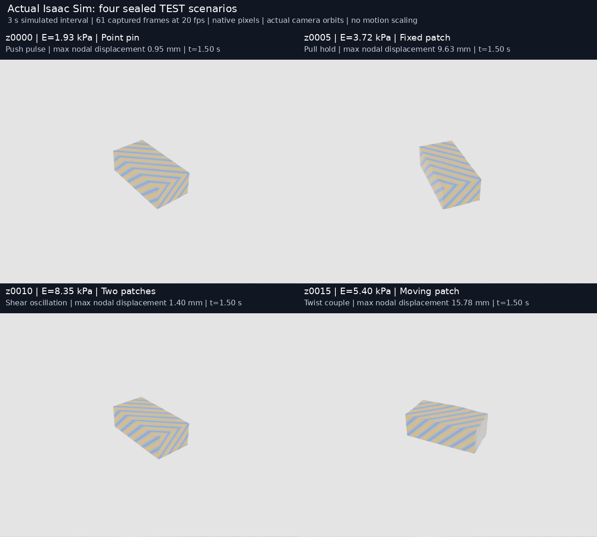
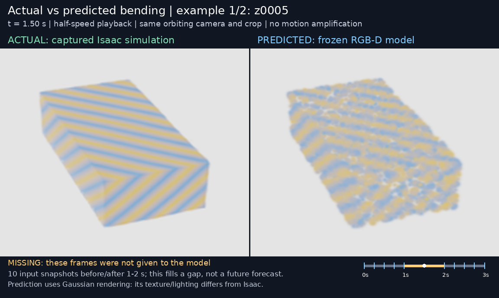

# Neural boundary and material benchmark

[Full sealed test report](../../reports/gaussian-sealed-study-v01/index.html) · [Formulation](../../docs/GAUSSIAN_NEURAL_ACTIVE_FORMULATION.md) · [Baseline audit](../../docs/GAUSSIAN_BOUNDARY_BASELINES.md)

This prototype learns physical hypotheses and direct-time deformation on a known cuboid with Gaussian appearance/support/load kernels. It uses supplied cameras, masks and reference geometry. It does not reconstruct a real COLMAP object or learn heterogeneous material fields.

The dataset contains 272 Isaac episodes. All saved frames passed sensor checks. Models were fitted on 152 TRAIN episodes, selected on 44 VAL episodes, then evaluated on 64 fresh TEST layouts and a separate 12-episode, four-layout secondary set.

| Fresh TEST task | Static | RGB flow | RGB-D flow |
| --- | ---: | ---: | ---: |
| Missing interval, 1–2 s | 0.843 mm | 0.761 mm | 0.727 mm |
| Forecast 2–3 s from inputs through 1 s | 0.718 mm | 0.732 mm | 0.680 mm |

The RGB-D forecast gain has a 95% layout-bootstrap interval spanning zero. Physical parameter posteriors remain poorly calibrated. Actual acquisitions cover 16 camera states and eight calibrated-probe objects; predictive-risk selection does not establish an advantage over strong fixed/random policies. A poke improves the unconditional-prior model's control prediction by about 18%, with nearly the same improvement from fixed or random pokes. The report includes priors, ridge, constrained chart posteriors, independent PIDG-inspired fitting, failures and confidence intervals. Official PIDG was not runnable; it is not represented as reproduced.

[Follow-up forward/inverse diagnosis](../../reports/gaussian-forward-inverse-diagnosis-v01/index.html): supplying true physical parameters still leaves substantial prediction error. The controlled teacher severely underpredicts six of eight known-force responses. A three-stiffness numerical simulator reference separates forward bias from a genuinely ambiguous layout. This conditional reference supplies supports/loads and does not establish a full calibrated physical posterior. No models or policies were changed.

[Active recovery campaign](../../docs/GAUSSIAN_RECOVERY_CAMPAIGN.md) · [Protocol](../../configs/gaussian_campaign_v01.json) · [Progress snapshot](campaign-status.json). Known-force loss/sampling ablations and additional Isaac control capture are running. Thirty-two newly reserved confirmation layouts are separate from the earlier TEST cases. Milestone gates must pass before uncertainty-guided probing is reassessed; no new performance gain is claimed at campaign launch.

[](isaac-test-scenarios.mp4)

[Watch the actual calibrated probe](isaac-test-calibrated-probe.mp4) · [Orbit video source hashes](isaac-test-scenarios.manifest.json) · [Probe video source hashes](isaac-test-calibrated-probe.manifest.json)

[](actual-vs-predicted.mp4)

[Watch actual versus predicted bending](actual-vs-predicted.mp4) · [Comparison source hashes](actual-vs-predicted.manifest.json)

In plain language: we made virtual soft blocks, changed their stiffness, holding points and applied forces, and taught a model to predict their bending from a few snapshots. We hid the middle of each test sequence and checked the prediction against the simulator. We also tested whether another camera angle or a poke helped. Filling missing motion improved on average; reliable material identification, uncertainty and smarter probing remain unresolved.

The comparison shows two visibly moving cases from the earlier montage, including a poor prediction. Left is captured Isaac RGB; right renders the frozen RGB-D model's mean prediction as Gaussian splats. Both use the same orbiting camera and crop. Texture and lighting differ between renderers. Playback is half speed with no deformation amplification. Ten input snapshots lie outside the marked 1–2 s missing interval: this is interpolation using earlier and later observations, not future forecasting. Reproduce with `OPENBLAS_NUM_THREADS=2 .venv/bin/python experiments/render_actual_prediction_video.py`.

## Data, models and reproduction

[The artifact index](artifacts.json) provides immutable commit URLs, checksums and file counts. Large raw files live on the artifact branch; source, protocols, reports and videos live on `main`. To obtain source without downloading the entire artifact history:

```sh
git clone --single-branch --branch main https://github.com/mohsenkhadem1/physgauss-sde.git
```

Download an archive's `manifest_url`, then use its `download_base_url` from the index:

```sh
python experiments/restore_research_artifacts.py \
  --manifest manifest.json --parts downloaded-parts --destination . \
  --download-base-url URL_FROM_ARTIFACT_INDEX
```

Restore final-study phases 02, 03 and 04 into the project checkout to recover datasets, checkpoints and results under their original relative paths. Historical phase 01 is optional and should be restored separately. Every part, archive and restored file is hash-checked; different existing files are never silently replaced. [Metadata notes](metadata-notes.json) clarify preserved historical headers and the corrected weighted-quantile diagnostic.
