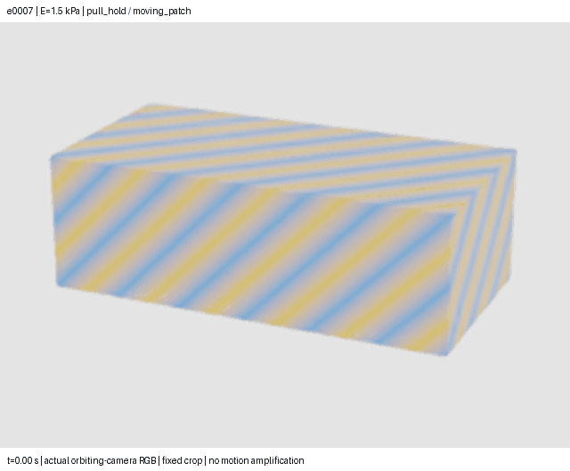

# Isaac block dataset with an orbiting camera

48 local Isaac Sim episodes cover **3 stiffness levels × 4 force families ×
4 boundary setups**, with seeded support/load locations and varied density,
Poisson ratio and damping. The actual camera moves through an 85–125° arc;
per-frame intrinsics/extrinsics are recorded. No deformation is amplified.

[Watch one soft-block episode](preview/single/simulation.mp4) ·
[Watch the paired-material montage](preview/simulation.mp4) ·
[Protocol and reproduction](../../docs/ISAAC_ORBIT_DATASET.md) ·
[Machine-readable results](results.json) · [Independent audit](audit.json)



| Split | Episodes | Dense RGB frames | Sparse RGB inputs |
|---|---:|---:|---:|
| Train | 24 | 1,464 | 240 |
| Validation | 12 | 732 | 120 |
| Test | 12 | 732 | 120 |
| Total | 48 | 2,928 | 480 |

Each RGB frame also has depth and an object mask. There are 61 frames over
3 seconds at 20 fps per episode; physics runs at 960 Hz. Sparse inputs use ten
frames, with a one-second interval between observations at 1 and 2 seconds.
The complete static reference has 4,096 Gaussian samples attached to a known
455-node, 1,728-tetrahedron volume mesh. Masks/cameras are supplied in this
controlled dataset. Depth is auxiliary; exclude it from an RGB-only experiment.

Materials use Young's modulus 1.5, 5 and 20 kPa. Loads are inward pulses,
outward pull/hold, oscillating shear and equal/opposite force couples.
Boundaries are a point pin, a fixed patch, two opposite fixed patches and a
prescribed moving patch. Forces act through two nine-node rigid patches with
1 g handles, rather than uniform pressure. Gravity is zero; there is no floor,
external contact or compliant/sliding support in this version.

Matched stiffness triplets share camera paths, forces, geometry and nuisance
parameters, and stay in the same split. The layout seeds are disjoint across
splits. This is one known object with 16 independently sampled interaction
layouts; it is a development dataset, not evidence of broad generalization.
Truth visibility labels separate visible, hidden and ambiguous Gaussian
samples. Full nodal motion, force histories and boundary labels stay in truth
files, apart from the sparse model observations.

## Data and restoration

The complete local data is in `runs/isaac-boundary-orbit-v01/`. Main contains
source, protocol, compact evidence and videos. Every raw episode, source
snapshot, camera/depth/mask record, worker log, preflight and rejected display-
GPU capture is preserved on the permanent artifact branch, indexed by
[raw-archive.json](raw-archive.json). Parts are verified against their Git blob
hashes; every source file was checked by an archive round trip.

Download and restore the complete data from a clone of main:

```sh
# Python 3.12+; standard library only. Choose a fresh output directory.
python experiments/restore_isaac_dataset.py --output restored-isaac
# Restored data:
# restored-isaac/runs/isaac-boundary-orbit-v01/
```

The restoration helper verifies each part and the combined archive SHA256
before safely extracting. An [end-to-end restore test](restoration-check.json)
recovered and hash-checked all 11,520 files. `file-manifest.json` lists every data file's size
and SHA256. `load_model_inputs()` reads only `reference.npz` and
`observations/`; never feed truth, recipes, catalogs or diagnostic labels to a
learner. For a boundary-only experiment, explicitly supply true material and
mass as a separately declared known-material condition.

## Verification and limits

All 48 retained episodes passed independent replay of forces, moments,
clocks, supports, camera paths, Gaussian attachments, geometry and sparse input
copies. The final audit ray-traces 11,520 sensor pixels against saved nodal
surfaces. Six deliberate corruptions test rejection of altered cameras,
forces, supports, provenance, recipes and extra sparse images. Eleven unit
tests cover the scenario design, geometry, loads, camera conventions,
visibility, input separation and original block helpers.

The largest depth-ray discrepancy is **1.63 micrometres**; maximum fixture drift
is **0.50 micrometres**, and the minimum runtime tetrahedron volume ratio is
**0.667**. Peak total motion is **25.77 mm**. Roughly **26–42%** of samples stay
hidden at all ten sparse observation times.

These are consistency checks at a fixed discretization. Spatial/time
convergence, calibrated physical accuracy and boundary-recovery performance
are not established. RGB comes from a mesh renderer; the supplied Gaussian
reference has not been optimized by a 3DGS reconstruction. No inverse model or
uncertainty comparison has been run on this data. Bird remains stopped.
