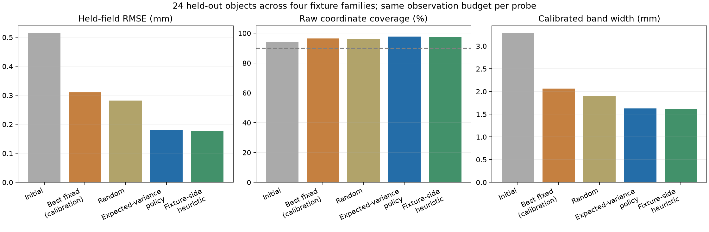
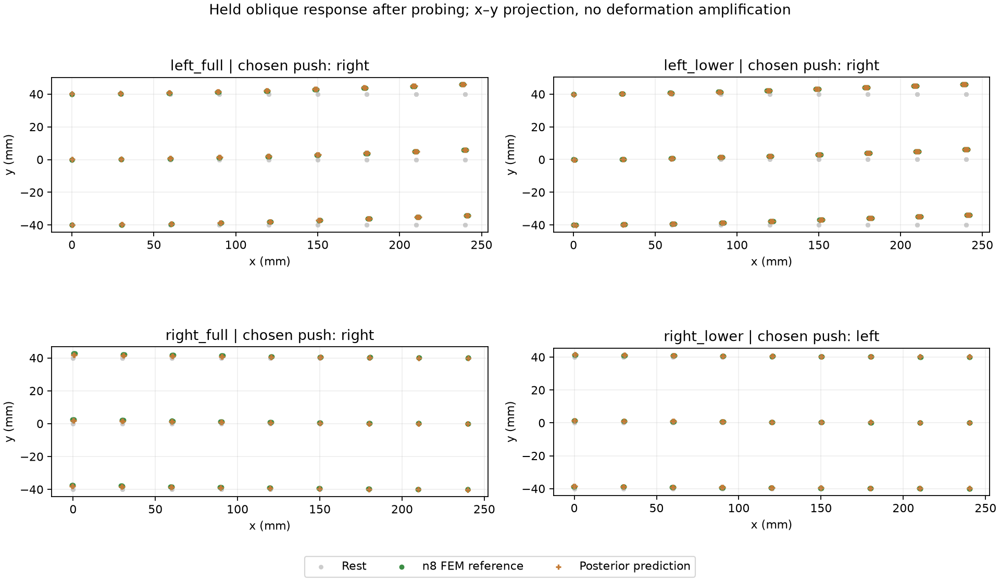

# Active probing with unknown support side and extent

2026-10-27. Object-dependent probing beats a strong fixed action on the frozen n8 FEM test. Expected-uncertainty planning does **not** beat a simpler inferred-support heuristic. This is a numerical-reference study, not a new PhysTwin training or image-reconstruction result.

## Experiment

A 240 × 80 × 80 mm nonlinear elastic block has one of four latent attachments: left full face, left lower half-face, right full face or right lower half-face. All are distributed isotropic Robin springs; the partial fixtures are compliant attachments, not exact hard clamps. Total attachment stiffness is normalized across footprint sizes. Material stiffness is log-uniform from 1.5–10 kPa and fixture stiffness from 400–16000 N/m. Fixture side/extent and both stiffnesses are unknown to the policies.

The initial observation contains 27 coordinates on the center cross-section under a common small load. Each candidate probe applies a 0.03 N transverse force to either end, resets from rest and observes three coordinates at that end's center. The target is all 243 coordinates of the object's response to a separate asymmetric oblique load. Thus an action selects both force location and observation location. Both actions have equal noise (0.3 mm SD) and equal observation budget; no real camera motion or force hardware is simulated.

There are 12 development objects, 20 calibration objects and **24 held-out test objects**, balanced across the four fixture families, with four noise repetitions each. New E/K pairs are held out. All four support families are represented in the forward bank: this is not out-of-prior generalization to unseen support topology. Rest geometry, applied loads, constitutive family, Poisson ratio and sensor noise are known. No gravity, contact or dynamic forecasting is included.

A small pilot found excessive rigid rotation for very loose supports. The prior and load were adjusted before the protocol was frozen or cohort outcomes examined. In the frozen development cohort, the most deforming probe has nonrigid coordinate RMS **0.187–0.966 mm**, about **8.1–13.1%** of total nodal motion RMS after removing best-fit rigid motion. The nonrigid numerator is volume weighted. Motion still contains a substantial rigid component, but these experiments provide much more deformation information than the earlier almost-rigid diagnostic.

## Algorithm and fair comparators

The posterior combines a latent four-way fixture label with continuous log E/log K quadrature. It uses the nonlinear FEM response bank and a shared numerical-discrepancy mean/covariance learned only from development residuals. Discrepancy covariance is conditioned jointly on initial and probe observations, including cross-correlations with the predicted field.

For each initial observation, the adaptive policy samples possible probe outcomes from its posterior predictive distribution and selects the action with lowest expected posterior **whole-field variance**. The sampler includes sensor noise and conditioned numerical discrepancy. Actual probe outcomes and held-field truth do not enter action selection.

Comparators are:

- **Best fixed:** choose the lower-error action on the independent calibration cohort and freeze it. This chose the left push.
- **Random:** exactly average both possible actions' squared errors, rather than rely on a lucky random draw. Whole-object coverage averages over independent random action choices across repetitions.
- **Fixture-side heuristic:** infer the more probable attached side from the same initial posterior and push the opposite end. It is not given the true fixture label. This comparator isolates the value of detailed expected-variance planning beyond simply localizing the fixture.

A single calibration multiplier, 2.0406, expands moment intervals to target simultaneous coverage across all coordinates, all repetitions and both probe choices (plus initial observations). Calibration uses an object-level maximum score and the 19th of 20 scores. Because this cohort fixes equal numbers per fixture family, coverage here is an empirical stratified-cohort result; we do not assert the usual iid split-conformal guarantee without qualification.

## Sealed test results

Errors are coordinate RMSE over the complete held-load field, aggregated over 24 objects and four repeats. All post-probe policies receive the same number of observations.

| Policy | RMSE (mm) | Raw nominal-90% coordinate coverage | Calibrated mean band width (mm) | Calibrated object coverage, all four repeats |
|---|---:|---:|---:|---:|
| Initial observation only | 0.514 | 93.9% | 3.284 | 23/24 |
| Best fixed from calibration | 0.310 | 96.5% | 2.064 | 24/24 |
| Random | 0.282 | 96.1% | 1.902 | 96.4% expected |
| Expected-variance policy | **0.181** | 97.7% | 1.629 | **24/24** |
| Inferred-support heuristic | **0.177** | 97.6% | 1.610 | **24/24** |

Adaptive error is 41.8% below the calibration-selected fixed policy and 35.9% below random. The right push happens to be the better fixed action on the test itself (0.251 mm); adaptive is still 28.0% lower. The test-selected fixed action is a hindsight diagnostic, not the deployed baseline.

Adaptive chose left in 34/96 trials and right in 62/96. It agreed with the fixture-side heuristic in 81/96 trials (84.4%). Detailed uncertainty planning has no demonstrated advantage over that heuristic; its point error is slightly worse. The bands are conservative: coordinate coverage around 98% is above, not equal to, the nominal 90%, and mean expanded width is about 1.6 mm. Whole-object success on 24 cases is encouraging but too small to establish broad population calibration.

Paired, fixture-stratified object bootstrap intervals and the frozen success checks are in `comparison.json` and `decision.json`. Coordinates and noise repetitions are not treated as independent objects. The adaptive RMSE improvement over the fixed baseline has a 95% interval of **0.0888–0.1643 mm**. Against the heuristic, the interval is **−0.0135 to +0.0088 mm**, including no advantage. The heuristic comparison must be retained when interpreting the result.





## Numerical and provenance audit

- A 9×9 n4 forward bank is built independently for each support family. Linear interpolation failed the frozen 0.03 mm development RMS tolerance on some objects; that failure is retained in `linear-interpolation-failure.json`. Cubic interpolation with a direct sparse solve passes the same tolerance. This development change occurred before calibration/test evaluation.
- Posterior refinement from 33×33 to 65×65 did not pass. Refinement from **65×65 to 129×129** passed on development, calibration and test, with all four fixture categories retained. On the test, the largest mean change was **0.00809 mm** and SD change **0.00337 mm**, below the frozen 0.01 mm threshold.
- Expected utilities use common Sobol samples from the posterior predictive distribution. Choices agree at 256 versus 1024 samples for all test trials. A 4096-sample fallback is implemented for disagreement. Development action choices also agree between parameter grids in 48/48 trials; a separate post-run test audit agrees in **96/96**. No published test choices were retuned by the audit.
- **18 tests pass**, including partial-face area/load conservation, FEM energy/tangent derivatives, force balance, analytic conditional-Gaussian utility, continuous posterior reference checks and the preceding posterior tests.
- Eight CPU workers generated the bank and object references. GPU 0 evaluated float64 posteriors and utilities. A separate two-worker CPU audit refined the lowest- and highest-mesh-error development objects to n12. Other jobs were not stopped.
- The pretest seal freezes protocol, policy sources, development fields and bank hashes, plus the fixed action and interval multiplier. The report builder verifies it again after testing. Raw simulation fields and prediction arrays stay local.

The n4-to-n8 mesh differences are **0.137–1.434 mm** on development objects, considerably larger than in v02. All twelve decrease relative to n2-to-n4 differences, but this does not establish continuum accuracy. For the two selected development objects, n8-to-n12 differences are **0.0337 mm and 0.5238 mm**. The latter is larger than the reported adaptive test RMSE and remains a material physical-accuracy limitation. Final equilibrium/Jacobian checks and the complete refinement record are published in `numerical-audit.json`. The inference explicitly models numerical discrepancy, yet its calibration target is still the **n8 finite-mesh field**. Do not interpret submillimetre prediction errors against that reference as equally accurate predictions of a mesh-independent continuum or real material.

## Decision

The narrow fixed-policy milestone is supported on the declared simulated distribution: action selection based on the individual observation improves held-load prediction without losing empirical interval coverage. The more ambitious claim—that detailed uncertainty planning is better than a simple fixture-aware rule—is **not supported**.

Use the fixture-side heuristic as the new strong baseline. A useful next family should make action choice depend on unresolved material/support trade-offs even after fixture side is localized, while better-resolved forward checks address the mesh sensitivity. This result does not justify adding a learned policy merely to reproduce an almost equally good rule. Transfer into PhysTwin remains deferred; its learned spring model has not inherited this posterior or these calibration results.

## Reproduction

Run from the repository root in the existing FEM/SciPy/PyTorch environment. The build resumes from individual files. Changing physics or parameters requires a new experiment version rather than reusing the caches.

```bash
OMP_NUM_THREADS=1 OPENBLAS_NUM_THREADS=1 MKL_NUM_THREADS=1 .venv/bin/python scripts/phystwin/active_support_reference.py --workers 8
CUDA_VISIBLE_DEVICES=0 OMP_NUM_THREADS=2 OPENBLAS_NUM_THREADS=2 .venv/bin/python scripts/phystwin/active_support_policy.py --stage development
CUDA_VISIBLE_DEVICES=0 OMP_NUM_THREADS=2 OPENBLAS_NUM_THREADS=2 .venv/bin/python scripts/phystwin/active_support_policy.py --stage calibrate
CUDA_VISIBLE_DEVICES=0 OMP_NUM_THREADS=2 OPENBLAS_NUM_THREADS=2 .venv/bin/python scripts/phystwin/active_support_policy.py --stage test
CUDA_VISIBLE_DEVICES=0 OMP_NUM_THREADS=2 OPENBLAS_NUM_THREADS=2 .venv/bin/python scripts/phystwin/audit_active_support.py
OMP_NUM_THREADS=1 OPENBLAS_NUM_THREADS=1 .venv/bin/python scripts/phystwin/refine_active_support.py
.venv/bin/python scripts/phystwin/summarize_active_support.py
.venv/bin/python -m pytest -q tests/test_phystwin_active_support.py tests/test_phystwin_uncertainty.py tests/test_phystwin_controlled_reference.py tests/test_phystwin_controlled_probing.py tests/test_phystwin_metrics.py
```

The report builder also requires the n2 development and selected n12 audit files, generated by `refine_active_support.py`. These are additional forward-only diagnostics; they do not tune the model or policy.
