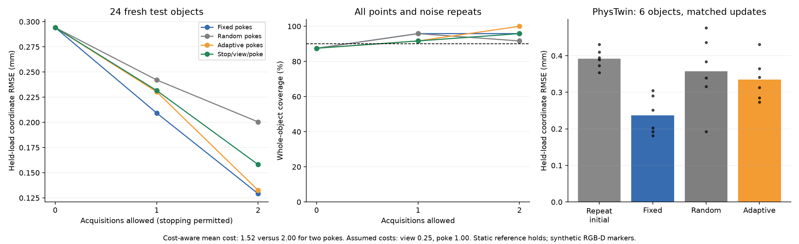

# Cost-aware views and pokes: v07

Fresh static nonlinear FEM objects; six reset pokes, a second calibrated view of the initial load, or stop. Assumed costs: view 0.25, poke 1; loss is posterior mean coordinate variance plus 0.01 mm^2 per cost unit. Myopic two-action horizon. Synthetic fiducials and known rest geometry. No dynamic or real-hardware claim.



## Held-out prediction

| Policy | Initial / one / two decision RMSE (mm) | Object coverage | Mean cost |
|---|---|---|---|
| fixed | 0.294 / 0.209 / 0.129 | 88% / 96% / 96% | 2.000 |
| random | 0.294 / 0.242 / 0.200 | 88% / 96% / 92% | 2.000 |
| adaptive_pokes | 0.294 / 0.230 / 0.133 | 88% / 92% / 100% | 2.000 |
| cost_aware | 0.294 / 0.232 / 0.158 | 88% / 92% / 96% | 1.521 |

The stationary rest-shape baseline has coordinate RMSE 0.543 mm. Rigid-aligned shape errors (initial / final mm): fixed: 0.144 / 0.049, random: 0.144 / 0.085, adaptive_pokes: 0.144 / 0.057, cost_aware: 0.144 / 0.065.

Coverage requires all 243 coordinates and all three noise repeats for an object. Bands are calibrated separately by policy and decision budget using 24 independent calibration objects. A stopped policy retains its prediction at subsequent budgets. Test has 24 objects, so coverage estimates are noisy. The quantile follows split-conformal calibration, but layouts were balanced by design rather than drawn IID; coverage is an empirical result here, not a claimed distribution-free guarantee.

Watch [actual versus predicted](actual-vs-predicted.mp4): median and worst final-error objects, actual deformation scale, static shapes with a moving camera.

## Cost-aware choices

{
  "stop_counts": {
    "0": 14,
    "1": 5,
    "2": 53
  },
  "view_count": 2,
  "mean_cost": 1.5208333333333333
}

Paired stratified object-bootstrap comparisons (positive improvement favors cost-aware):

```json
{
  "fixed": {
    "mean_object_rmse_improvement_mm": -0.03757972091104484,
    "paired_95_interval_mm": [
      -0.05666523273486108,
      -0.019768190155491198
    ],
    "cost_adjusted_mse_improvement_mm2": -0.0035096905050689014,
    "cost_adjusted_interval_mm2": [
      -0.010420512119426737,
      0.0035877639788075054
    ]
  },
  "random": {
    "mean_object_rmse_improvement_mm": 0.03528631131678728,
    "paired_95_interval_mm": [
      0.006469306717287213,
      0.06550342006269824
    ],
    "cost_adjusted_mse_improvement_mm2": 0.019984463728582726,
    "cost_adjusted_interval_mm2": [
      0.008736559712300014,
      0.03199670769920244
    ]
  },
  "adaptive_pokes": {
    "mean_object_rmse_improvement_mm": -0.023936888985231875,
    "paired_95_interval_mm": [
      -0.03883848790127698,
      -0.010989716815325045
    ],
    "cost_adjusted_mse_improvement_mm2": -0.0026348575238193447,
    "cost_adjusted_interval_mm2": [
      -0.00902050888362416,
      0.0017911999092264607
    ]
  }
}
```

## Numerical limits

Planning uses 33³ quadrature points per layout and 128 simulated outcomes. Final predictions use 65³. Refinement checks below concern the saved predictions, not the selected actions. They are reported rather than treated as evidence of convergence when unresolved.

```json
{
  "fixed": {
    "max_mean_change_mm": 0.11647769467428211,
    "rms_mean_change_mm": 0.002221156432471737,
    "max_sd_change_mm": 0.02182899580238434,
    "scope": "Saved histories only; policy selected on 33^3 per layout, predictions and calibration on 65^3. Does not establish action convergence."
  },
  "random": {
    "max_mean_change_mm": 0.0054685686405398296,
    "rms_mean_change_mm": 0.0002665769530264663,
    "max_sd_change_mm": 0.009440846758287175,
    "scope": "Saved histories only; policy selected on 33^3 per layout, predictions and calibration on 65^3. Does not establish action convergence."
  },
  "adaptive_pokes": {
    "max_mean_change_mm": 0.006893091824383387,
    "rms_mean_change_mm": 0.0004206802548161288,
    "max_sd_change_mm": 0.010531365340563287,
    "scope": "Saved histories only; policy selected on 33^3 per layout, predictions and calibration on 65^3. Does not establish action convergence."
  },
  "cost_aware": {
    "max_mean_change_mm": 0.006366998310142289,
    "rms_mean_change_mm": 0.00040633352997343383,
    "max_sd_change_mm": 0.010531365340563287,
    "scope": "Saved histories only; policy selected on 33^3 per layout, predictions and calibration on 65^3. Does not establish action convergence."
  }
}
```

Stopping is not uniformly safe: in the largest stopped-error case, the policy stops before useful information is collected. The four largest stopped-case errors are below; these are post-test diagnostics, not tuning cases.

```json
[
  {
    "object": 23,
    "repeat": 2,
    "history": [],
    "stopped_rmse_mm": 0.4313135731837155,
    "two_poke_rmse_mm": 0.25372049637831967
  },
  {
    "object": 23,
    "repeat": 0,
    "history": [],
    "stopped_rmse_mm": 0.4028868703629681,
    "two_poke_rmse_mm": 0.2085401392064456
  },
  {
    "object": 7,
    "repeat": 2,
    "history": [
      3
    ],
    "stopped_rmse_mm": 0.22132987255236297,
    "two_poke_rmse_mm": 0.06160676983257344
  },
  {
    "object": 15,
    "repeat": 1,
    "history": [
      3
    ],
    "stopped_rmse_mm": 0.20921630730276441,
    "two_poke_rmse_mm": 0.10892333015812565
  }
]
```

## Frozen earlier uncertainty on the fresh cohort

```json
{
  "rmse_mm": 0.2942728635173921,
  "object_coverage": 0.8333333333333334,
  "covered_objects": 20,
  "scope": "Frozen v06 model and band multiplier on fresh objects; different development/calibration data than v07, so an end-to-end comparison, not an isolated covariance ablation."
}
```

## Matched PhysTwin comparison

Completed 24/24 fits with timestep checks. Six fresh objects, four policies, identical 91-frame trajectories, 27 visible markers, 30 epochs and optimizer settings. The no-new-force control repeats the initial load three times. Adaptive actions use sparse Bayesian observations; all PhysTwin policies fit the same richer marker set. This compares action sequences within PhysTwin, not PhysTwin versus the Bayesian model. One optimizer seed; ramp targets interpolate static endpoints and are not validated dynamic truth.

[Watch all six fixed-versus-adaptive PhysTwin cases](phystwin-fixed-vs-adaptive.mp4).

| Object | Policy | Held-load RMSE mm | Half-step RMSE mm |
|---|---|---|---|
| 0 | repeat_initial | 0.389 | 0.389 |
| 0 | fixed | 0.192 | 0.192 |
| 0 | random | 0.192 | 0.192 |
| 0 | adaptive_pokes | 0.341 | 0.341 |
| 1 | repeat_initial | 0.354 | 0.354 |
| 1 | fixed | 0.291 | 0.290 |
| 1 | random | 0.316 | 0.316 |
| 1 | adaptive_pokes | 0.273 | 0.273 |
| 2 | repeat_initial | 0.395 | 0.395 |
| 2 | fixed | 0.202 | 0.202 |
| 2 | random | 0.340 | 0.340 |
| 2 | adaptive_pokes | 0.313 | 0.313 |
| 3 | repeat_initial | 0.431 | 0.431 |
| 3 | fixed | 0.252 | 0.252 |
| 3 | random | 0.476 | 0.476 |
| 3 | adaptive_pokes | 0.431 | 0.431 |
| 4 | repeat_initial | 0.410 | 0.410 |
| 4 | fixed | 0.305 | 0.305 |
| 4 | random | 0.436 | 0.436 |
| 4 | adaptive_pokes | 0.285 | 0.285 |
| 5 | repeat_initial | 0.373 | 0.373 |
| 5 | fixed | 0.182 | 0.182 |
| 5 | random | 0.384 | 0.384 |
| 5 | adaptive_pokes | 0.365 | 0.365 |

## Finer prediction audit

```json
{
  "scope": "Post-hoc saved-history prediction audit, 65 to 97 cubed per layout. Calibration multipliers and selected actions unchanged; primary results stay on 65. No policy retuning.",
  "policies": {
    "fixed": {
      "max_mean_change_mm": 0.02462948409748039,
      "rms_mean_change_mm": 0.0004590587506825541,
      "max_sd_change_mm": 0.004334251963678589,
      "refined_rmse_mm": [
        0.2941519737008532,
        0.2089985754069515,
        0.12917810857147635
      ],
      "refined_object_coverage": [
        0.875,
        0.9583333333333334,
        0.9583333333333334
      ]
    },
    "random": {
      "max_mean_change_mm": 0.0010281927941202182,
      "rms_mean_change_mm": 4.9455443065832375e-05,
      "max_sd_change_mm": 0.0017805642173475932,
      "refined_rmse_mm": [
        0.2941519737008532,
        0.2421283198800145,
        0.20044969059226717
      ],
      "refined_object_coverage": [
        0.875,
        0.9583333333333334,
        0.9166666666666666
      ]
    },
    "adaptive_pokes": {
      "max_mean_change_mm": 0.0012785489571069415,
      "rms_mean_change_mm": 7.848024461642874e-05,
      "max_sd_change_mm": 0.001994253921807905,
      "refined_rmse_mm": [
        0.2941519737008532,
        0.23034034620052832,
        0.13251546749866686
      ],
      "refined_object_coverage": [
        0.875,
        0.9166666666666666,
        1.0
      ]
    },
    "cost_aware": {
      "max_mean_change_mm": 0.0011961204713258067,
      "rms_mean_change_mm": 7.584043949151313e-05,
      "max_sd_change_mm": 0.001994253921807905,
      "refined_rmse_mm": [
        0.2941519737008532,
        0.23163882258550084,
        0.15806905213382627
      ],
      "refined_object_coverage": [
        0.875,
        0.9166666666666666,
        0.9583333333333334
      ]
    }
  }
}
```

Action refinement diagnostic: 10/11 saved decisions agree on the finer grid. First six test objects, first noise repeat; 33-to-65 cubed per-layout quadrature at identical 128 outcome samples. Evaluates saved histories, never substitutes refined actions. Not a full action or outcome-sampling convergence proof. One audited second-step choice switches between a poke and a view; the refined cost-adjusted variance gap is about 0.00010 mm², so action identity is not fully converged near ties.

Adaptive PhysTwin paired improvement (positive favors adaptive), with exploratory six-object bootstrap intervals:

```json
{
  "repeat_initial": {
    "mean_mm": 0.057105888351837386,
    "paired_95_interval_mm": [
      0.0369250624708777,
      0.07728671423279708
    ]
  },
  "fixed": {
    "mean_mm": -0.09753670523763337,
    "paired_95_interval_mm": [
      -0.11458683916959518,
      -0.08048657130567156
    ]
  },
  "random": {
    "mean_mm": 0.02253327785045044,
    "paired_95_interval_mm": [
      -0.027878760143012975,
      0.07294531584391385
    ]
  }
}
```

Mean PhysTwin held-load RMSE (mm): `{"repeat_initial": 0.3919254589805425, "fixed": 0.2372828653910716, "random": 0.35735284847915544, "adaptive_pokes": 0.334819570628705}`. Individual cases above show the variation; six objects and one optimizer seed are exploratory evidence.

## Deformation signal

Rigid-motion removal leaves a median 38% of held-load displacement RMS (range 12–51%) across the 24 test objects. Median nonrigid held-load motion is 0.187 mm; the initial-load median is only 0.064 mm. These scenarios contain shape change, but its absolute magnitude remains small relative to camera noise. The second view sees the same three initial-load markers from a new angle; it does not reveal new markers or observe the stronger probe deformation. This limits what the view-versus-poke comparison establishes. See [deformation diagnostics](deformation.json).

## Real-object pilot

Deferred by the user: this campaign focuses on simulation. [A future protocol](REAL_PILOT.md) is available, but no hardware acquisition is claimed or pending. Raw datasets and fitted checkpoints remain local.
