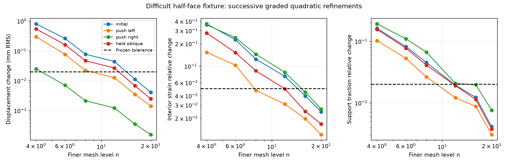

# Difficult half-face fixture: numerical reference qualification

This study fixes the boundary discretization and qualifies the difficult v03
development fixture before rebuilding inverse inference or comparing probing policies.
The automated numerical verdict and every retained failed refinement are in
[summary.json](summary.json) and [convergence.md](convergence.md).

## Result

**All four loads pass.** Both n=12→16 and n=16→20 graded spatial refinements pass every frozen spatial gate. The n=20 q3→q4 re-solves also pass for all four loads. No tolerance was relaxed.

| Load | Final RMS change (mm) | Strain change (%) | Traction change (%) | Quadrature RMS change (mm) |
|---|---:|---:|---:|---:|
| initial | 0.004143 | 2.445 | 0.413 | 6.713e-07 |
| push_left | 0.001426 | 1.207 | 0.306 | 6.515e-07 |
| push_right | 0.000158 | 2.653 | 0.763 | 4.173e-09 |
| held_oblique | 0.002497 | 1.680 | 0.377 | 3.249e-07 |

The worst final spatial RMS change is 0.00414 mm against a 0.02 mm limit. These are successive-mesh differences, not a claimed absolute error bound. **25 tests pass**, including GPU/CPU assembly, energy/tangent derivatives, independent sparse solvers, exact boundary integration, and gate rejection tests. See [tests.txt](tests.txt).

The corrected fine reference differs from the old n=8 reference by 1.377 mm RMS on the held oblique load for this object. The old policy comparison has not been rerun or treated as validated by this qualification.

## Problem and correction

The case was selected before these solves: development object 11, right lower
half-face support, Young's modulus 1956.6543 Pa, total support stiffness 568.8552
N/m. The block is 240 × 80 × 80 mm, Poisson ratio 0.35. All four v03 loads are
retained, including the held oblique load. These are static log-J Neo-Hookean
solutions without gravity, impacts, contact, or changing supports.

The old lumped surface spring energy gives excessive rotational resistance on
coarse half-face meshes. For an affine displacement proportional to the vertical
coordinate measured from the half-face center, the ratio to the exact surface
integral is 3 at n=2, 1.5 at n=4, 1.125 at n=8 and 1.05556 at n=12. Translation
stiffness alone would not detect this error. The new consistent surface mass
matrix integrates affine spring energy exactly, and quadratic surface shape
products are integrated exactly. Constant traction is also integrated consistently.
The continuum boundary law remains t = −(K/A)u in the reference configuration.

Quadratic tetrahedra resolve deformation more effectively than linear elements,
but uniform refinements still fail the original accuracy gates. Grading places
more elements near the supported end and the half-face edge. The domain, support
area, applied loads, material law, and tolerances remain fixed. Failed uniform
and early graded refinements remain in the results.

## Qualification rules

The frozen protocol requires inter-mesh displacement RMS ≤0.02 mm, maximum
coordinate difference ≤0.1 mm, relative strain L2 difference ≤5%, relative support
traction L2 difference ≤2%, and energy difference ≤1%. The summary conservatively
checks both elastic and spring energy. Equilibrium force, moment, and nonlinear
residual limits are 1e−8 N, 1e−9 Nm, and 1e−9 N respectively.

Displacements use 425 common structured points. Green–Lagrange strains use 512
fixed scrambled Sobol interior points; support tractions use 64 fixed interior
surface points. These are sampled field criteria, not peak-stress bounds at the
sharp support edge. We require the last two successive graded refinements to
pass for each load, plus an independent q3→q4 quadrature re-solve at the finest
mesh: displacement RMS ≤1 μm and energy change ≤0.01%.

This is finite numerical convergence evidence for one deliberately difficult
fixture, not a rigorous bound on continuum error or a qualification of the entire
material/support population. Positive Jacobians are checked at integration and
reference-element check points, not certified everywhere in each deformed element.

## Implementation and reproducibility

FP64 element energy, forces and tangent assembly run on GPUs 0–2. Sparse Newton
systems run on CPU, using the optional MKL-backed
[PyPardiso solver](https://github.com/haasad/PyPardiso). The original linear-system
residual is checked after each solve. No diagonal regularization changes the
physical problem. Newton/Armijo and CPU/GPU assembly parity are regression tested.
GPU 3 remains reserved; raw fields stay local under
`runs/phystwin-fixture-convergence-v04/fields/`.

The shared quadratic element class retains its default 8 GiB prospective memory
limit; this study explicitly allows a 24 GiB assembly estimate. That estimate is
not a hard resident-memory cap: sparse factorization can use more memory.
Fine runs therefore need memory monitoring and limited concurrency. The n=20
mesh has 192,000 quadratic tetrahedra, 270,641 nodes and 811,923 unknown displacement
components; CPU factorization dominates its runtime.

Commands and the optional pinned solver dependencies are in
`scripts/phystwin/README.md` and `scripts/phystwin/requirements-fixture.txt`.
The protocol and refinement addenda record the progression from uniform meshes
to graded n=12,16,20, without relaxing the tolerances.

## Motion and legacy-reference diagnostics

[legacy-reference-difference.json](legacy-reference-difference.json) compares the
old v03 n=8 reference with the latest consistent graded P2 solution at the same
81 observation points. These differences include both boundary-integration and
volume-discretization changes; they do not isolate either contribution. They
are a single-object diagnostic, not a population error estimate. A same-mesh
P1 n=12 comparison isolates the boundary-integration change: 0.315 mm RMS for the
initial load and 0.231 mm RMS for the held oblique load; see
[boundary-integration-difference.json](boundary-integration-difference.json).

[motion-diagnostic.json](motion-diagnostic.json) separately fits and removes a
best-fit rigid transformation at the 425 common points. The residual quantifies
deformation rather than whole-object movement. Numerical convergence alone does
not establish that these loads identify elasticity and support independently.

## Consequence for the research campaign

The v03 policy comparison remains a development result on an unconverged
reference. It must not be promoted to evidence of calibrated material/boundary
inference or superior active probing. After reference qualification, rebuild a
small reference posterior and calibrate predictive uncertainty on withheld
parameters and actions; then compare uncertainty-based probing against the
strong fixture-side heuristic, fixed and random probes. Transfer to PhysTwin
comes after these reference and inference checks.
