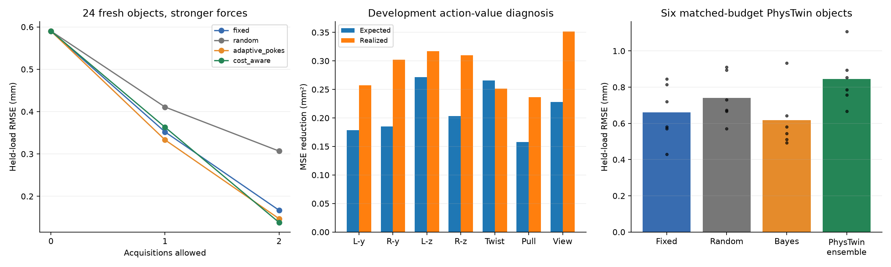

# Informative deformation and model-specific action selection: v08

Fourfold localized/held forces and sixteenfold distributed initial force; gravity unchanged. New right-end view measures nine additional points under the stronger initial load. Same nonlinear material and two uncertain supports. Static reference holds, synthetic tracked RGB-D, known forces/geometry. PhysTwin ensemble disagreement is a heuristic, not calibrated information gain.



## Held-out prediction

| Policy | Initial / one / two acquisitions RMSE mm | Whole-object coverage | Mean cost |
|---|---|---|---|
| fixed | 0.590 / 0.352 / 0.167 | 88% / 96% / 100% | 2.000 |
| random | 0.590 / 0.411 / 0.307 | 88% / 96% / 100% | 2.000 |
| adaptive_pokes | 0.590 / 0.333 / 0.147 | 88% / 100% / 96% | 2.000 |
| cost_aware | 0.590 / 0.363 / 0.138 | 88% / 96% / 92% | 1.372 |

The view-or-poke policy reduces pooled prediction RMSE by 17.2% and assumed acquisition cost by 31.4% relative to fixed pokes. The mean paired per-object RMSE benefit is 0.010 mm, with exploratory 95% bootstrap interval [-0.020, 0.044] mm. That interval includes no benefit; pooled RMSE and mean per-object RMSE are different aggregations. This is promising cost-sensitive behavior, not established superiority over fixed pokes.

Stationary rest-shape baseline: 2.004 mm. 24 fresh test objects, three noise repeats each. Coverage requires every sampled coordinate and repeat for an object. Calibration uses 24 separate objects, per policy and budget. Balanced layouts mean coverage is an empirical audit, not a claimed distribution-free guarantee. Acquisition costs are assumed: view 0.25, poke 1; stopping penalty 0.01 mm² per cost unit.

[Watch actual versus predicted shapes](actual-vs-predicted.mp4). The video includes median and worst final-error cases at actual deformation scale.

## Does predicted information value match actual improvement?

With true development-object physical parameters, raw forward-model held-load RMSE is 0.058 mm (0.047 mm after the development bias correction). Camera coordinate error is 0.273 mm. [Oracle diagnosis](development-forward-oracle.json).

Bayesian diagnostic: all seven actions on 12 development objects × three repeats. Mean within-observation rank correlation: 0.318; best-action agreement: 13.9%. Expected reduction in posterior target variance is compared with realized held-load MSE reduction. A realized noisy outcome is not an expectation.

PhysTwin diagnostic: all six force candidates on three development objects, one per support layout. Mean rank correlation between ensemble disagreement and realized squared-error improvement: -0.276. Each action fit and repeated-initial control has 61 frames, 27 markers and 1800 updates. These are development-only diagnoses; test outcomes do not tune either selector.

[Bayesian action details](development-action-value.json) · [PhysTwin action details](phystwin-development-action-value.json)

## Matched PhysTwin action comparison

| Policy | Mean held-load RMSE mm |
|---|---|
| fixed | 0.660 |
| random | 0.741 |
| adaptive_pokes | 0.617 |
| ensemble | 0.844 |

Bayesian-selected pokes improve mean PhysTwin error by 0.043 mm versus fixed pokes, with exploratory 95% paired interval [-0.054, 0.139] mm. This six-object mean improvement is inconclusive.

Ensemble selected the same unordered pair as the fixed baseline on 0/6 objects; ordering can still affect optimization.

These PhysTwin policies are compared within the same spring model and dense observation pipeline. The separate FEM-Bayesian predictor uses sparse measurements and the known three-parameter material/support family; its absolute errors are not a matched-model comparison with PhysTwin.

Six fresh objects. Every final fit has 91 frames, 27 visible markers and 2700 updates. Fixed, random, FEM-Bayesian adaptive and PhysTwin-ensemble-selected actions use the same final training budget. The ensemble selector fits three initial-only models at spring initializations 0.05/0.1/0.2 using exactly the same nine RGB-D prefix coordinates as Bayes, interpolated through the load ramp. It receives no candidate response or held-load target. It ranks predicted candidate-marker disagreement and takes the top two as a batch; the Bayesian policy updates after its first observation. The ensemble spends 2700 additional selection updates per object, which fixed/random choices do not require. Disagreement is a heuristic, not calibrated uncertainty.

[Watch fixed versus ensemble PhysTwin predictions](phystwin-fixed-vs-ensemble.mp4). Rollouts are compared against interpolated static equilibrium targets; only settled holds support quantitative scores. Transients are not validated dynamic ground truth.

Ensemble improvement (positive favors ensemble), with exploratory six-object paired bootstrap intervals:

```json
{
  "fixed": {
    "mean_mm": -0.18400274674821074,
    "paired_95_interval_mm": [
      -0.24259318069372574,
      -0.12541231280269585
    ]
  },
  "random": {
    "mean_mm": -0.1027807285086683,
    "paired_95_interval_mm": [
      -0.1596153904103985,
      -0.04594606660693812
    ]
  },
  "adaptive_pokes": {
    "mean_mm": -0.22666941473819804,
    "paired_95_interval_mm": [
      -0.2792026949972899,
      -0.17413613447910617
    ]
  }
}
```

## Numerical and deformation checks

An eightfold localized-load stress pilot was archived after a development-case PCG/Armijo failure. The production study uses fourfold localized/held loads and a sixteenfold distributed initial load, selected before held-out policy scoring. Initial force is 0.16 N and single localized forces reach 0.32 N; gravity remains the deliberately weak 0.02 N total, not Earth gravity. All 60 production references pass the unchanged displacement/equilibrium checks. Stronger loads exposed GPU PCG failures; v08 retries with rebuilt linear caches and, when necessary, incremental loading, preserving the final force and acceptance criteria. See local checkpoint/log history.

Median nonrigid held-load displacement: 0.410 mm; median initial-load nonrigid displacement: 0.156 mm. Median nonrigid fraction of held-load motion is 33.0%. Fractions and per-action ranges: [deformation diagnostics](deformation.json).

Development utility-sampling audit: 6/6 initial decisions agree between 64 and 256 simulated outcomes. [Sampling audit](utility-sampling.json).

Planning and primary prediction use 65³ quadrature nodes per layout. [97³ prediction audit](prediction-refinement.json) retains selected actions and calibration multipliers. It does not establish action-selection or outcome-sampling convergence. Physical-parameter calibration and superior probing are separate claims from accurate deformation prediction.

## Reproducibility

[Run and recovery notes](run-notes.json) · [Artifact validation](artifact-validation.json) · [Implementation provenance](implementation-provenance.json) · [Frozen input hashes](sealed-input-hashes.json). Raw datasets/checkpoints remain local. Code, derived metrics, tests and videos are published. Prior v06/v07 seals are preserved. Simulation only; no hardware results claimed.
