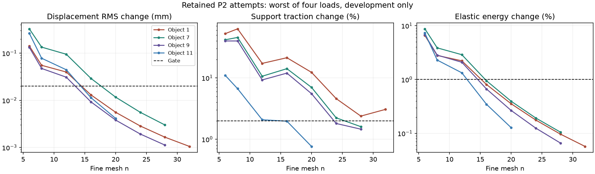

# Development numerical diagnosis

Snapshot: 2026-10-27T18:33:55Z. 12/12 development references qualified. This snapshot does not claim a completed held-out comparison.

The P2 displacement changes became small sooner than support-force changes. Small position error alone did not validate the support response. The figure retains the original P2 attempts, including failures. Accuracy gates were not loosened.

The validated replacement uses Q2 hexahedra concentrated near support edges: x-power-2 grading, cosine grading toward y edges and the z support cut/outer edges, with four times as many z cells. It uses the same log-J material and consistent Robin surface law. The candidate sequence n=6,10,14,18,22 retains two consecutive spatial passes and q3/q4 checks under all four loads. Basis reproduction, affine energy, energy/force/tangent differentiation, surface integration, and exact full-support translation are tested.

Both required development fixtures qualified. The independent comparison against the previously qualified P2 reference for development object 11 is:

| Load | Displacement RMS difference (mm) | Traction relative difference | All cross-checks pass |
|---|---:|---:|---|
| initial | 0.004266 | 0.221% | True |
| push_left | 0.002187 | 0.140% | True |
| push_right | 0.000384 | 0.257% | True |
| held_oblique | 0.002637 | 0.194% | True |

An additional Q2 n=18-to-20 check on the stiff object's initial load also passes: RMS difference 0.00002372 mm, traction difference 0.162%. This additional check covers one load; the accepted reference separately passed all four loads and quadrature checks.

The numerical method is enabled only through the hashed [validation](tensor-validation.json) and [adoption rule](tensor-reference-adoption.json). Already-qualified P2 fields are preserved. New half-face references use edge-refined Q2; full-face references retain P2 with qualified Q2 fallback. This is simulator meshing, not disclosure of the true fixture to inference or probing policies.

The P2 n=40 continuation was stopped after n=32 failed: a single final pass could not satisfy the two-pass rule. The separate finer Q2 run was retained through its completed initial-load check, then stopped before an unnecessary second load. Completed fields and failure audits remain local.

Reproduce candidate qualification with `.venv/bin/python scripts/phystwin/qualified_tensor_reference.py --index 1` and `--index 11`; enable it with `validate_tensor_reference.py` only after its checks pass. The additional finer diagnostic is available through `diagnose_tensor_fixture.py --case 1 --edge-grading --levels 12 16 20 --actions initial`. Raw fields remain under `runs/phystwin-qualified-support-v05/`. Supervisor status and logs are under `status/`.

These are finite numerical checks, not absolute continuum-error bounds or validation against real measurements. Calibration/test results do not select this method.
