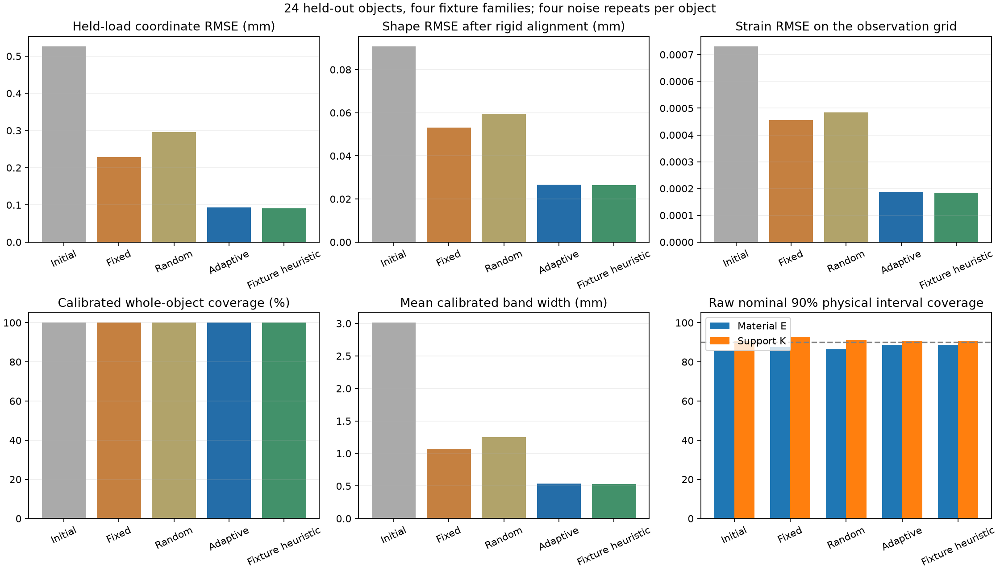

# Qualified nonlinear reference, uncertainty and probing — v05

The preregistered active-probing success criteria were not all met. Failed checks: advantage over the fixture heuristic.

All 56 reference objects passed their recorded spatial and quadrature checks. This is finite numerical qualification under specified sampled-field tolerances, not an absolute continuum-error proof or physical validation against real measurements.

## Held-out results

| Policy | Coordinate RMSE (mm) | Aligned shape RMSE (mm) | Whole-object band coverage | Band width (mm) | E interval coverage | K interval coverage |
|---|---:|---:|---:|---:|---:|---:|
| Initial | 0.5266 | 0.0908 | 100.0% | 3.012 | 85.4% | 90.6% |
| Fixed | 0.2288 | 0.0530 | 100.0% | 1.074 | 87.5% | 92.7% |
| Random | 0.2965 | 0.0594 | 100.0% | 1.249 | 86.5% | 91.1% |
| Adaptive | 0.0934 | 0.0267 | 100.0% | 0.535 | 88.5% | 90.6% |
| Fixture heuristic | 0.0908 | 0.0263 | 100.0% | 0.527 | 88.5% | 90.6% |

## Does adaptive probing beat the strong baselines?

| Baseline | Adaptive coordinate RMSE improvement (mm) | Paired object-bootstrap 95% interval (mm) |
|---|---:|---|
| fixed | 0.1355 | [0.0546, 0.2126] |
| random | 0.2032 | [0.1532, 0.2539] |
| fixture_side_heuristic | -0.0026 | [-0.0123, 0.0041] |

Positive intervals support an advantage over that baseline. Intervals containing zero do not. Bootstrap resampling is stratified by fixture family and clustered by object; four noise repeats are not counted as four independent objects. Aligned-shape and coarse-grid strain comparisons are retained in [comparison.json](comparison.json).

## Numerical and inference checks

One unqualified test reference required an initialization repair: the analytically uniform translation was only 1.42e-13 m from the exact solution, but roundoff exceeded the frozen absolute zero-strain and traction checks. The exact uniform displacement was supplied as the initial state to the unchanged sealed solver. All original residual and qualification gates then passed. Original checkpoints and failed audits remain local; [repair hashes and checks](initialization-repairs.json) record the change. Deforming loads, accepted references, model, calibration and tolerances were unchanged.

The original v04 gates remain: displacement RMS 0.02 mm, maximum coordinate difference 0.1 mm, strain relative L2 5%, support traction relative L2 2%, energy 1%, and equilibrium tolerances. Every object requires two consecutive spatial passes and a finest-mesh q3/q4 check. Exact same-face full-support translations use the analytic zero-strain solution instead of relative errors of numerical zero. [qualification.json](qualification.json) retains the per-object evidence and identifies the accepted element space. If the development-validated Q2 fallback is enabled, its method and cross-space validation are included in the accompanying addenda; prior failed P2 attempts remain recorded.

The forward surrogate is selected only on development data using a 30 μm RMS accuracy gate; [model-selection.json](model-selection.json) records rejected candidates. Posterior refinement checks predictive means, standard deviations and physical marginal quantiles. The categorical fixture is latent. Known geometry and known forces are supplied. No true fixture label is given to a policy.

Calibration required additional posterior integration levels before sealing: predictive moments had stabilized, but physical quantiles failed at 257 and again at 513 nodes per parameter. The unchanged log-quantile tolerance is 0.02. The [numerical extension](posterior-refinement-extension.json) records the doubled refinement sequence and memory-bounded three-GPU execution; priors, likelihood, model and acceptance gates were unchanged. Failed checks remain in the calibration convergence record.

Expected-risk means use an exact contraction through the existing cubic B-spline bases and coefficients. Every posterior node remains included; dense component norms and second moments are retained. There is no rank truncation or new physical approximation. [Dense/structured execution tests](tests-exact-spline.txt) and the [actual-surrogate benchmark](exact-spline-mean-benchmark.json) check equivalence. Independent action risks run concurrently on separate GPUs.

Joint numerical discrepancy is fitted on development residuals, then conditioned on both initial and probe observations. Twenty new calibration objects determine the fixed action and a common object-wise prediction-band multiplier; [seal.json](seal.json) hashes the model and data before held-out evaluation. Raw physical parameter intervals are not disguised as calibrated prediction bands. [confidence-after-probing.json](confidence-after-probing.json) flags intervals that narrow while errors or coverage worsen. [Physical interval uncertainty](physical-interval-bootstrap.json) includes stratified object-bootstrap intervals for coverage, error and width, including paired changes after probing. Noise repeats are averaged within each object before resampling.

Utility choices stable under sampling refinement: 96/96. Choices agreeing under posterior-grid refinement: 96/96. All scientific pass/fail decisions are recorded in [decision.json](decision.json).

## Confidence after probing

| Parameter | Change in raw 90% coverage | Paired object-bootstrap 95% interval | Change in absolute log-median error | Paired object-bootstrap 95% interval |
|---|---:|---|---:|---|
| E | 3.12 percentage points | [-5.21, 11.46] | -0.1919 | [-0.2394, -0.1469] |
| K | 0.00 percentage points | [-6.25, 7.29] | -0.1846 | [-0.2726, -0.0940] |

Positive coverage changes and negative error changes are favorable. Narrower intervals alone are not evidence of better inference. These are raw physical intervals; prediction-band calibration does not calibrate them.

## Privileged action diagnostic

| Choice | Expected held-force RMSE (mm) | Agreement with oracle action |
|---|---:|---:|
| fixed | 0.2300 | 55.2% |
| random | 0.2985 | — |
| fixture_side_heuristic | 0.0909 | 84.4% |
| adaptive | 0.0935 | 84.4% |
| oracle | 0.0604 | 100.0% |

This diagnostic gives the action evaluator the true object's responses, then integrates future probe noise with 512 samples. It keeps the fitted predictor fixed. It is not an eligible policy, not used for tuning, and its expected errors are not directly comparable to the realized-outcome table above. Oracle action choices agree between 128 and 512 samples in 96/96 cases; disagreement limits interpretation of this diagnostic. Gaps include uncertainty about the hidden object, not just policy computation error. [Full diagnostic](oracle-audit.json).

## Are these objects actually deforming?

| Split | Minimum best-probe nonrigid RMS (mm) | Median (mm) | Minimum nonrigid / total RMS | Median ratio |
|---|---:|---:|---:|---:|
| development | 0.238 | 0.500 | 9.4% | 11.5% |
| calibration | 0.229 | 0.514 | 9.1% | 11.2% |
| test | 0.210 | 0.542 | 6.3% | 11.2% |

This diagnostic removes best-fit rigid translation and rotation. The table uses each object's available probe with the largest nonrigid RMS. For probes actually chosen by the adaptive policy on test observations, minimum nonrigid RMS is 0.000 mm and minimum nonrigid/total RMS is 0.0%. These percentages are RMS amplitude ratios, not fractions of motion variance. In 6/96 observations, the selected probe produces less than 1 nm nonrigid coordinate RMS: essentially uniform translation. This is a post-evaluation descriptive diagnostic, not a changed acceptance criterion. Thus informative probes are available for every object, but the policy does not always select one. [Per-object and per-load evidence](deformation-audit.json).

## Limits

This is a static synthetic study with four known fixture families and continuous material/support stiffness variation. It does not establish general spatial boundary inference, new topology generalization, gravity/contact performance, or learned PhysTwin uncertainty. Coordinate error includes rigid movement; aligned shape error removes it. Strain is computed on the 81-point observation grid, not interpreted as peak boundary stress.

Pooled prediction calibration has nominal 90% coverage. The balanced fixture sampling is stratified, so an unconditional exchangeability guarantee is not assumed. Test coverage is measured on only 24 independent objects; material coverage averages four noisy observations per object. Small differences should not be overinterpreted.

GPU multigrid accelerates the unchanged nonlinear equations; the original linear and nonlinear residuals are checked. Tangent temporaries and quadrature gradients are streamed. CPU/direct-solver parity evidence is retained in [solver-validation.json](solver-validation.json). Raw fields remain local.

## Actual versus predicted shapes

[Watch the comparison](actual-vs-predicted.mp4). It shows the median and worst test objects by adaptive prediction error, before and after the chosen probe. The camera moves around static held-force shapes; this is not a dynamics forecast. Deformation is shown at its actual scale. [Selection details](video-selection.json).
