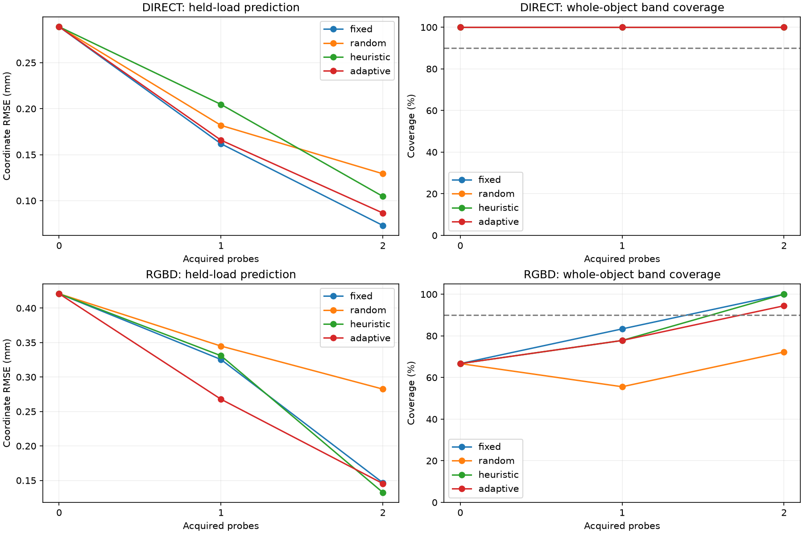

# Multi-support sequential probing and visual PhysTwin bridge — v06

The useful result is earlier information from RGB-D: the first adaptive probe improves held-load prediction over fixed, random and response-based choices. Two probes substantially improve prediction, but adaptive selection is not uniformly best after the second probe. This is graded pilot evidence, not a binary pass/fail verdict.

## What changed

A 240 × 80 × 80 mm nonlinear block has compliant patches on both ends. Material stiffness and the two support stiffnesses vary independently and continuously; three categories move the support patches between lower, upper and opposing lateral halves. Six competing probes include localized pushes, opposite-direction twisting loads and axial stretch. A separate oblique load is held out for prediction. Known weak gravity contributes 0.02 N total (equivalent to 0.0208 m/s² for the 0.96 kg block). Each probe is a reset experiment, and the second choice conditions on the first measured response.

The split is 6 development, 12 calibration and 18 held-out objects, with three observation repetitions per object. Fixed sequences use development data only. Random and adaptive policies receive the same two-probe budget; the heuristic chooses the largest posterior-predicted marker motion. No true support label enters a policy. Bootstrap resampling is stratified by layout and clustered by object.

## Held-out prediction

| Observations | Policy | Before probes (mm) | After one (mm) | After two (mm) |
|---|---|---:|---:|---:|
| direct | fixed | 0.289 | 0.162 | 0.073 |
| direct | random | 0.289 | 0.182 | 0.129 |
| direct | heuristic | 0.289 | 0.205 | 0.105 |
| direct | adaptive | 0.289 | 0.166 | 0.087 |
| rgbd | fixed | 0.421 | 0.325 | 0.147 |
| rgbd | random | 0.421 | 0.345 | 0.282 |
| rgbd | heuristic | 0.421 | 0.331 | 0.133 |
| rgbd | adaptive | 0.421 | 0.268 | 0.145 |

## What benefit is supported?

Positive differences favor adaptive probing. These are paired object-bootstrap 95% intervals in millimetres; the two budgets are reported separately.

| Observations | Baseline | First-probe improvement interval | Two-probe improvement interval |
|---|---|---|---|
| direct | fixed | [-0.022, 0.012] | [-0.030, 0.002] |
| direct | random | [-0.003, 0.037] | [0.018, 0.067] |
| direct | heuristic | [-0.009, 0.091] | [-0.007, 0.042] |
| rgbd | fixed | [0.006, 0.112] | [-0.049, 0.051] |
| rgbd | random | [0.034, 0.118] | [0.063, 0.217] |
| rgbd | heuristic | [0.016, 0.114] | [-0.056, 0.036] |

The first RGB-D probe has a supported benefit against all three baselines in this cohort. After two probes, adaptive beats random, while fixed and heuristic differences remain inconclusive. Direct-point observations also benefit from probing, but the fixed sequence has the best mean two-probe score. These are exploratory comparisons across two observation models and budgets, not multiplicity-adjusted confirmatory claims.

## Uncertainty and numerical resolution

| Observations | Adaptive coverage: 0 / 1 / 2 probes | Sampling-choice agreement | Finest primary grid |
|---|---|---|---:|
| direct | 100.0% / 100.0% / 100.0% | 100/108 | 65³ per layout |
| rgbd | 66.7% / 77.8% / 94.4% | 106/108 | 65³ per layout |

Prediction bands are calibrated on 12 separate objects, pooling policies and budgets conservatively. The RGB-D initial and one-probe bands under-cover this test cohort; two-probe coverage improves. Thus we do not claim uniformly calibrated uncertainty. Raw physical-parameter intervals are reported separately in [comparison.json](comparison.json), and prediction-band calibration does not calibrate them.

The primary 33→65 grid comparison did not meet every diagnostic tolerance (10 μm mean/SD and 0.05 log-parameter quantiles). A post-evaluation 97³-per-layout audit holds every saved action and calibration multiplier fixed. All saved prediction histories then meet those tolerances: the largest mean change across policies is 7.4 μm, SD change 4.2 μm, and log-quantile change 0.0171. This supports numerical stability of the reported predictions; it does not establish action-choice stability at the finer grid.

| Observations | Adaptive maximum mean change, 65→97 (mm) | RMS mean change (mm) | Refined RMSE after two probes (mm) |
|---|---:|---:|---:|
| direct | 0.00454 | 0.00013 | 0.087 |
| rgbd | 0.00128 | 0.00006 | 0.145 |

All 36 references passed sampled-displacement spatial/quadrature checks, equilibrium residuals and positive-Jacobian checks. Thirty used mesh level 6 and six used level 8. These are displacement-qualified references, not the stricter v05 traction/strain qualification and not experimental validation. The new boundary energy gradient and tangent were checked independently. The fast model’s development target RMS errors range from 0.003 to 0.035 mm; six development objects are a limited discrepancy-training sample.

## Visual observations and PhysTwin

The RGB-D bridge rasterizes perspective surface depth and colored fiducials at 640×480. It measures marker centroids and backprojects noisy depth; measured coordinate error is approximately 0.26 mm. Cameras, rest geometry and marker identities are known. This is a controlled vision interface, not raw-video tracking, COLMAP reconstruction, Gaussian appearance fitting or a foundation-model evaluation.

The official PhysTwin dense fitter is run on three bridge cases within the held cohort, one per support layout. An isolated opt-in adapter supplies known nodal forces; candidate anchors span both end faces, without supplying true patch labels or stiffnesses. It receives 27 visible markers per frame, whereas the sparse Bayesian policy gets three initial markers and one per probe. Consequently this is a richer-observation integration test, not a budget-matched PhysTwin-versus-FEM ranking.

| Object | Initial-only PhysTwin held error (mm) | After two probe interactions (mm) | Stationary reference error (mm) | Maximum timestep-refinement change (mm) |
|---:|---:|---:|---:|---:|
| 0 | 0.512 | 0.337 | 0.362 | 0.00052 |
| 1 | 0.480 | 0.323 | 0.961 | 0.00058 |
| 2 | 0.433 | 0.172 | 0.453 | 0.00053 |

Both fits use 30 epochs, so the three-interaction fit also gets more frame-level optimizer updates. Improvement cannot be attributed solely to action selection. Checkpoints are selected using training loss; the oblique load never enters fitting. Ramp targets interpolate static equilibria; final-hold comparisons and drift are reported, but the video is not validated dynamic ground truth. PhysTwin uncertainty is not learned here; the Bayesian posterior remains a separate physics reference.

## Diagnosis of the old six weak probes

Five of six nearly rigid v05 probes followed a mistaken maximum-posterior support-side estimate. The true-side probabilities were roughly 29–58%, so ambiguity, not just numerical instability or high-confidence certainty, matters. One probe with negligible strain still gave a favorable realized noisy prediction; lack of deformation alone is not a sufficient failure label. [Saved-action diagnosis](v05-action-diagnosis.json).

## Reproduction and artifacts

Raw FEM fields, images, depth, checkpoints and training inputs remain under `runs/phystwin-sequential-support-v06`. Code and derived summaries/videos are published. See [the implementation instructions](../../scripts/phystwin/README.md). The direct and RGB-D seals hash numerical inputs before held-out scoring. The source adapter and force-kernel check are published, and the original PhysTwin checkout remains unchanged.

[View Bayesian actual-versus-predicted shapes](actual-vs-predicted.mp4). [View the PhysTwin bridge](phystwin-held-force.mp4). Selection and visualization scope are recorded in [video-selection.json](video-selection.json).
