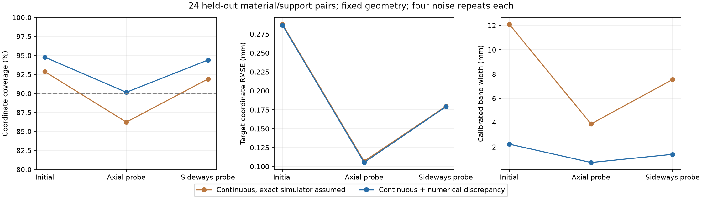

# Continuous physical uncertainty: diagnosis, correction and held-out test

2026-10-27. The reference uncertainty model now behaves substantially better on new material/support pairs. This is a numerical FEM posterior, not uncertainty learned by PhysTwin and not a new PhysTwin training result.

## What was wrong

Replaying the previous experiment with exactly the same observations and posterior isolates a concrete problem. After probing, its discrete intervals covered **100% of the coarse forward bank's truth but only 44.6% of the independent fine-mesh truth**. **25.1% of coordinate intervals had zero width.** Before probing, the corresponding coverages were 98.8% and 66.8%. Discrete state collapse plus unmodelled numerical discrepancy therefore explains a substantial demonstrated failure; this does not prove every source of model error has been identified.

## What changed

- Replaced the nine-state prior with a continuous log-uniform prior over stiffness E = 1.5–10 kPa and support stiffness K = 40–1600 N/m. An interpolated 9×9 nonlinear FEM response bank supports refined posterior quadrature, instead of treating nine physical explanations as exhaustive.
- Estimated a joint numerical-discrepancy mean and covariance from **12 development objects**. The residual is the fine n8 field minus the interpolated n4 response. The covariance uses 10% diagonal shrinkage and a 1 µm diagonal standard-deviation floor, specified before fitting. It includes cross-correlations between observed and predicted locations.
- Kept **20 calibration objects** separate to set an object-level split-conformal expansion, then evaluated **24 held-out objects**, each with four independent noise repetitions. Parameters are independently sampled from the declared prior. Geometry, Poisson ratio, fixture form and actuator stiffness are fixed; these are new physical parameter pairs, not new shapes or boundary layouts.
- Preserved the initial right-end observation, 0.3 mm observation noise, reset axial/sideways probes at a midpoint marker and held oblique prediction target. Probe sensing still requires access to an initially hidden marker. This is not force-only active perception.

All responses are quasistatic, with known rest geometry and actuator displacement, and no gravity or contact. They test transfer to a held load direction, not forecasting a dynamic trajectory.

The three observation budgets are: initial end observations; those observations plus the axial midpoint probe; and those observations plus the sideways midpoint probe. All prediction scores cover the complete 81-point oblique displacement field. No held-out truth is used to choose discrepancy settings or interval expansion.

## Held-out results

Unexpanded Gaussian moment intervals are labelled nominal 90%; they are not exact mixture equal-tail credible intervals. Coordinate coverage measures the fraction of true target coordinates inside those intervals, averaged over the 24 objects and four repeats.

| Observation budget | RMSE, corrected model (mm) | Coverage without discrepancy | Coverage with discrepancy | Corrected interval width (mm) |
|---|---:|---:|---:|---:|
| Initial end only | 0.287 | 92.9% | 94.8% | 0.783 |
| Add axial midpoint probe | **0.105** | 86.2% | **90.2%** | 0.253 |
| Add sideways midpoint probe | 0.179 | 91.9% | 94.4% | 0.490 |

The axial observation reduces RMSE by **63.2%** relative to the initial observations. Its RMSE is 0.105 mm versus 0.147 mm for the exact equal-weight random average over the two reset probes. The object-bootstrap 95% interval for that fixed-versus-random RMSE difference is 0.0216–0.0634 mm. This is a fixed-action result, not evidence of adaptive superiority. No adaptive policy is run in this study.

The continuous-only and corrected models have similar point errors: after axial probing, 0.107 versus 0.105 mm. The numerical correction mainly improves uncertainty, rather than producing a large accuracy gain.

The post-axial physical-parameter interval coverages are **85.4% for E and 89.6% for K**. Prediction calibration does not establish calibrated material inference. The conformal expansion described below applies to displacement fields, not to those material intervals.

## Whole-field bands and their cost

A second, stricter target is simultaneous coverage of **every coordinate, all four repetitions and all three observation budgets for an object**. Calibration uses one score per object: its maximum error divided by the nominal half-width. The 19th of 20 ordered scores sets the 90% split-conformal scale; scales are never reduced below one. This targets coverage under exchangeability with the stated synthetic object/noise distribution.

Without discrepancy the required scale was **15.46×**; with discrepancy it was **2.85×**. On the sealed test:

| Model | Simultaneously covered test objects | Mean band width after axial probe |
|---|---:|---:|
| Continuous only, calibrated | 20/24 | 3.900 mm |
| Continuous + discrepancy, calibrated | **24/24** | **0.722 mm** |

These conservative bands cover much more than a typical coordinate. They should not be confused with the narrower nominal intervals in the first table. The corrected bands cover all tested fields at all three observation budgets, but **24/24 is a small sample**: the exact binomial 95% interval is approximately **85.8–100%**, so this does not certify population coverage above 90%. Raw nominal intervals covered all budgets/repeats simultaneously for only 1/24 objects, which is not surprising for a coordinate-wise interval and is why the simultaneous calibration is reported separately.



## Numerical qualification and validation

The forward bank uses n4 tetrahedral Neo-Hookean FEM; independent n8 solutions supply development/calibration/test truth. There are 149 parameter/mesh jobs, each containing three actions and eight continuation steps. All converged: maximum equilibrium residual 9.94e-10 N, minimum deformation Jacobian 0.9848. No inverted elements occurred in the recorded solves.

At the 12 development parameters, interpolation-versus-direct-n4 RMS ranged from 0.00045 to 0.00570 mm, below the frozen 0.01 mm gate. Direct n4-to-n8 differences ranged from 0.0123 to 0.0194 mm. This is a finite-mesh reference study: no n16 proof of continuum accuracy is supplied. Numerical discrepancy is explicitly part of the prediction model rather than silently identified with physical variability.

All development, calibration and test posterior checks passed when refining from **65×65 to 129×129** integration nodes. On the test, the corrected model's largest change was 0.00242 mm in a predictive mean and 0.00201 mm in a predictive standard deviation; log-parameter quantile changes were below 0.00536. Frozen tolerances were 0.005 mm for each predictive quantity and 0.01 for log-parameter quantiles. No failed quadrature run is presented as converged; no further grid level was needed. These are explicit finite refinement checks, not an analytic integration-error bound.

**14 tests pass**, including energy/tangent derivatives, force balance, an independent truncated-normal solution for the continuous quadrature, analytic Gaussian conditioning and object-level conformal ranking. Pretest hashes freeze 109 bank/development/model/calibration inputs; verification passed after testing. FEM ran in eight CPU workers. Posterior likelihoods and moments ran in float64 on GPU 0. Other GPU jobs were not modified. Raw fields and prediction arrays remain local.

## Technical model

Let theta = (log E, log K), f(theta) be the interpolated n4 displacement field for all three interactions, and delta ~ Normal(b, C) be the development-estimated numerical discrepancy. Observed coordinates satisfy y = H[f(theta) + delta] + epsilon, with epsilon ~ Normal(0, sigma² I), sigma = 0.3 mm. Thus the likelihood covariance is H C Hᵀ + sigma² I.

The posterior integrates this likelihood against the continuous log-uniform prior using nested trapezoidal quadrature. For each theta, target discrepancy is conditioned on the observed residual using the full cross-covariance C_target,observed. Predictive moments integrate both parameter uncertainty and the conditional discrepancy variance. Intervals use mean ± 1.64485 standard deviations; the independent calibration stage then expands these intervals for simultaneous coverage. The Gaussian discrepancy is an empirical approximation from 12 development objects, not a physically complete model-error distribution.

## Limits and decision

This addresses a demonstrated uncertainty failure and establishes a useful continuous numerical reference. It does **not** establish that PhysTwin's learned spring parameters have this posterior, that raw images support the same precision, or that prediction intervals transfer to unseen shapes, contact, gravity, changed fixture topology, real materials or unknown loads. Same-geometry parameter variation and known sensor noise make this a controlled diagnosis.

A strong fixed axial probe already wins against random here. Before making an adaptive-policy claim, use the reference to test a new frozen family with differing support locations/directions and action-dependent usefulness, then test an approximate learned posterior against this reference. Preserve the separate calibration and test splits, include a strong fixed-action comparator and assess both width and coverage. The present test set must not be reused to tune that next model.

## Reproduction

From the repository root, with the existing FEM/SciPy/PyTorch/pytest/matplotlib environment:

```bash
OMP_NUM_THREADS=1 OPENBLAS_NUM_THREADS=1 MKL_NUM_THREADS=1 .venv/bin/python scripts/phystwin/uncertainty_reference.py --workers 8
CUDA_VISIBLE_DEVICES=0 OMP_NUM_THREADS=2 OPENBLAS_NUM_THREADS=2 .venv/bin/python scripts/phystwin/uncertainty_posterior.py --stage development
CUDA_VISIBLE_DEVICES=0 OMP_NUM_THREADS=2 OPENBLAS_NUM_THREADS=2 .venv/bin/python scripts/phystwin/uncertainty_posterior.py --stage calibrate
.venv/bin/python scripts/phystwin/freeze_uncertainty.py
.venv/bin/python scripts/phystwin/freeze_uncertainty.py --verify
CUDA_VISIBLE_DEVICES=0 OMP_NUM_THREADS=2 OPENBLAS_NUM_THREADS=2 .venv/bin/python scripts/phystwin/uncertainty_posterior.py --stage test
.venv/bin/python scripts/phystwin/summarize_uncertainty.py
.venv/bin/python scripts/phystwin/audit_discrete_uncertainty.py
.venv/bin/python -m pytest -q tests/test_phystwin_uncertainty.py tests/test_phystwin_controlled_reference.py tests/test_phystwin_controlled_probing.py tests/test_phystwin_metrics.py
```

The discrete replay additionally requires the local v01 bank and saved observations. FEM jobs resume from individual files; use a new output/version if changing the experiment or solver. Published JSON files include the frozen protocol, calibration seal, numerical checks, both test-model summaries, paired object-bootstrap summaries and the original discrete failure diagnosis. Large generated arrays remain under `runs/phystwin-uncertainty-v02`.
